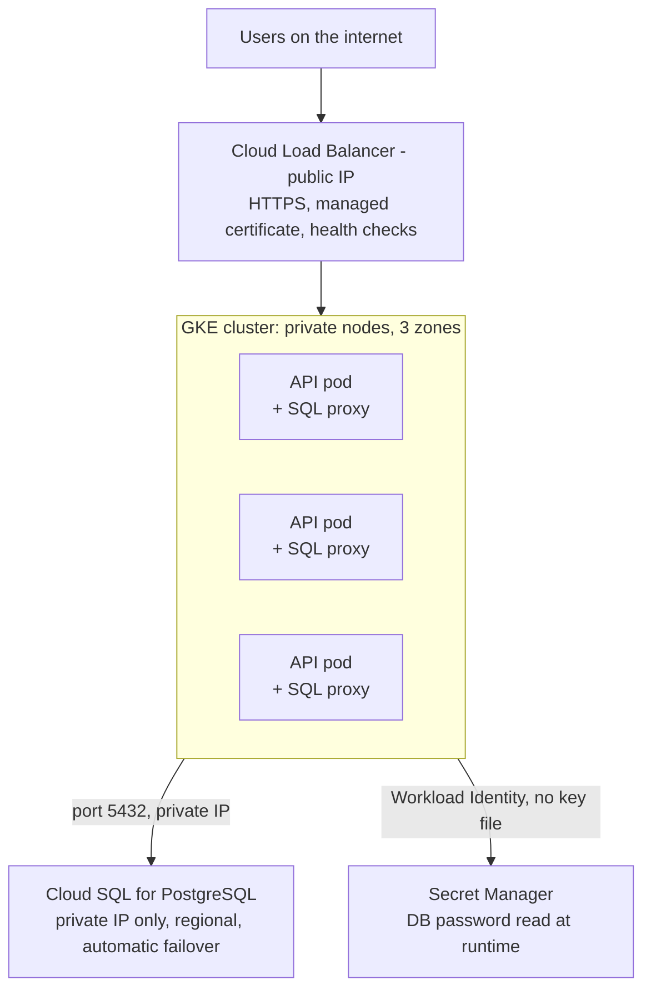
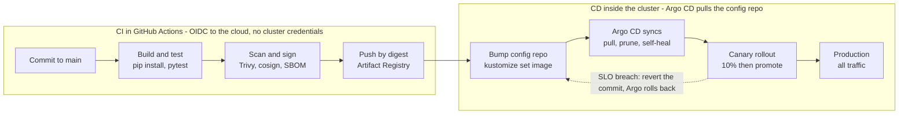

# Cloud & Kubernetes Interview Prep Course

As of October 17, 2026

## How to use this course

The interview tests four technical things: deploy a two-tier app to the cloud, stand up Kubernetes clusters, build CI/CD pipelines, and configure cloud-native security. The target role is the Wiz Technical Account Manager (Mid-Atlantic) posting, so Module 8 adds the product and CNAPP vocabulary, cloud threat models, and the customer-facing TAM motion that posting also asks for. Module 0 starts on your laptop with one container and one web service, and every later module reuses that same code and image; each module pairs a short concept brief with a lab you run yourself and the interview questions that lab answers. Do the labs; interviewers can tell the difference between someone who has read about `kubectl rollout` and someone who has watched one fail.

The labs use Google Cloud (GKE, Artifact Registry, Cloud Build) as the primary platform, with the AWS and Azure equivalents named at every step so you can answer for whichever cloud the interviewer uses. The example app is a Python Flask API (tier 1) backed by PostgreSQL (tier 2), small enough to deploy in an afternoon and realistic enough to discuss trade-offs.

**Lab setup (do this once, about 30 minutes)**

- [ ] Google Cloud project with billing enabled, plus `gcloud` CLI installed and authenticated (`gcloud auth login`, `gcloud config set project PROJECT_ID`)
- [ ] Enable APIs: `gcloud services enable container.googleapis.com artifactregistry.googleapis.com cloudbuild.googleapis.com secretmanager.googleapis.com`
- [ ] Install `kubectl`, `helm`, `docker` (or Podman), `terraform`, and `trivy`
- [ ] A GitHub account and an empty repo named `two-tier-app`
- [ ] Optional: `kind` or `minikube` for a free local cluster to practice manifests before paying for GKE

| Concept | Google Cloud | AWS | Azure |
| --- | --- | --- | --- |
| Managed Kubernetes | GKE | EKS | AKS |
| Container registry | Artifact Registry | ECR | ACR |
| Managed PostgreSQL | Cloud SQL | RDS | Azure Database for PostgreSQL |
| Native CI/CD | Cloud Build / Cloud Deploy | CodeBuild / CodePipeline | Azure Pipelines |
| Secrets | Secret Manager | Secrets Manager / SSM | Key Vault |
| Pod-to-cloud identity | Workload Identity | IRSA / Pod Identity | Workload Identity |
| Image scanning | Artifact Analysis | ECR scanning (Inspector) | Defender for Containers |
| Admission policy | Policy Controller (Gatekeeper) | Gatekeeper / Kyverno | Azure Policy for AKS |

**Budget note:** a 3-node GKE Standard cluster on e2-medium costs roughly $0.30/hour plus the cluster fee (one zonal cluster per account is free of the management fee). Run the teardown script when you finish each day (see Teardown, after Module 7), or at minimum delete the cluster: `gcloud container clusters delete two-tier --zone us-central1-a`.

## Module 0: Start on your laptop, one container at a time

Before any cloud account, run the whole two-tier app on your own machine. Every later module reuses this exact code and image, so by the time you reach GKE the only new thing is the platform. The starter repo (`two-tier-app-starter.zip`) has the code; this module is the ladder you climb with it. Budget about 70 minutes.

**The app, in one screen.** A Python Flask API, one file, with five routes: `GET /` (which replica answered, which storage is in use), `GET /healthz/live`, `GET /healthz/ready`, `GET /notes`, `POST /notes`. With no `DB_HOST` it keeps notes in memory; set `DB_HOST` and the same code uses PostgreSQL. That switch, driven only by environment variables, is the thing to internalize: one image, many environments.

```python
# app.py (abridged; the full file is in the starter repo)
import os, socket
from flask import Flask, jsonify, request

app = Flask(__name__)
DB_HOST = os.environ.get("DB_HOST")          # unset = in-memory mode
store = PostgresStore() if DB_HOST else MemoryStore()

@app.get("/")
def index():
    return jsonify(service="two-tier-api", storage=store.mode, hostname=socket.gethostname())

@app.get("/healthz/live")                     # process alive? never touches the DB
def live():
    return "ok"

@app.get("/healthz/ready")                    # can this replica serve? checks the DB
def ready():
    try:
        store.ping()
        return "ready"
    except Exception as exc:
        return f"database unreachable: {exc}", 503

@app.get("/notes")
def list_notes():
    return jsonify(store.list())

@app.post("/notes")
def add_note():
    text = (request.get_json(silent=True) or {}).get("text", "")
    if not text:
        return jsonify(error="text is required"), 400
    return jsonify(store.add(text)), 201
```

It runs under gunicorn in the container (`gunicorn app:app`), which handles SIGTERM gracefully so Kubernetes can drain a pod before stopping it. `python app.py` runs it without Docker when you just want to poke at the code.

**Step 1 (15 min): one container, one web service**

The first Dockerfile is deliberately plain; Module 2 hardens it.

```dockerfile
# Dockerfile.step1
FROM python:3.12-slim
WORKDIR /app
COPY requirements.txt .
RUN pip install --no-cache-dir -r requirements.txt
COPY app.py .
ENV PORT=8080
EXPOSE 8080
CMD ["gunicorn", "--bind", "0.0.0.0:8080", "app:app"]
```

```bash
docker build -f Dockerfile.step1 -t two-tier-api:0.1.0 .
docker run --rm -p 8080:8080 two-tier-api:0.1.0
# second terminal
curl localhost:8080/
curl -X POST localhost:8080/notes -H 'content-type: application/json' -d '{"text":"first note"}'
curl localhost:8080/notes
```

Stop the container (Ctrl-C), start it again, and `GET /notes` is empty. A container's memory dies with it. Say that sentence out loud; it is the reason a second tier exists and the reason the app tier must be stateless.

**Step 2 (10 min): look inside the container**

```bash
docker run -d --name api -p 8080:8080 two-tier-api:0.1.0
docker ps                       # running containers
docker logs api                 # gunicorn writes access and error logs to stdout; nothing to a file
docker exec -it api sh          # a shell inside the container
docker inspect api | head -40   # image digest, env, network, mounts
docker stats api --no-stream    # cpu and memory in use
docker stop api && docker rm api
```

Each command maps to something you will do on Kubernetes later: `docker logs` becomes `kubectl logs`, `docker exec` becomes `kubectl exec`, `docker inspect` becomes `kubectl describe`.

**Step 3 (15 min): add the database with Compose, two tiers on one laptop**

```yaml
# compose.yaml
services:
  api:
    build: .
    ports: ["8080:8080"]
    environment:
      DB_HOST: db                       # the service name is the DNS name
      DB_USER: app
      DB_NAME: app
      DB_PASSWORD_FILE: /run/secrets/db_password
    secrets: [db_password]
    depends_on:
      db: { condition: service_healthy }
  db:
    image: postgres:16-alpine
    environment:
      POSTGRES_USER: app
      POSTGRES_DB: app
      POSTGRES_PASSWORD_FILE: /run/secrets/db_password
    volumes: [pgdata:/var/lib/postgresql/data]
    healthcheck:
      test: ["CMD-SHELL", "pg_isready -U app"]
      interval: 5s
secrets:
  db_password: { file: ./db_password.txt }
volumes:
  pgdata:
```

```bash
cp db_password.txt.example db_password.txt   # never commit the real file
docker compose up --build
```

`POST /notes`, then `docker compose restart api`, then `GET /notes`: the note is still there, because it lives in the `db` container's volume, not in the API. `GET /` now says `"storage": "postgres"` and no code changed. Three things to notice: the API found the database by the service name `db` (Compose runs a DNS server, as Kubernetes will), the password arrived as a file rather than a baked-in value, and `depends_on` with a health check kept the API from starting before Postgres was ready.

**Step 4 (20 min): the same image on local Kubernetes**

```bash
kind create cluster --name lab
kind load docker-image two-tier-api:0.1.0 --name lab   # no registry yet
kubectl apply -f k8s-local/                            # Deployment (2 replicas) + Service
kubectl get pods -w                                    # wait for Running and 1/1 Ready
kubectl port-forward svc/api 8080:80
```

`curl localhost:8080/` several times and watch `hostname` change: the Service is spreading requests over two replicas. `kubectl delete pod <one>` and watch the Deployment replace it within seconds. Then `kubectl logs`, `kubectl exec`, `kubectl describe pod` on one of them and compare to Step 2. The database is not in this cluster, so the app is back in memory mode; that is on purpose. Module 4 attaches a managed database rather than running Postgres inside the cluster, and Lab 4.2 has you try the in-cluster version so you can explain why.

**Step 5 (10 min): the production image**

```bash
docker build -t two-tier-api:0.2.0 .     # the multi-stage, non-root Dockerfile
docker images two-tier-api               # compare sizes
docker run -d --name api2 -p 8080:8080 two-tier-api:0.2.0
docker exec -it api2 id                  # uid=10001(appuser): not root, by design
docker exec -it api2 pip --version       # fails: no pip in the runtime image
```

Both results are features, and Module 2 explains every line of the Dockerfile that produced them.

**Cleanup for this module**

```bash
docker compose down -v
kind delete cluster --name lab
docker rmi two-tier-api:0.1.0 two-tier-api:0.2.0
```

**Interview questions this module answers**

- What is a container? (A process with its own view of the filesystem, network, and process table, enforced by Linux namespaces and cgroups. Not a VM; it shares the host kernel.)
- Where did the data go when the container restarted? (Container filesystems are ephemeral. Persistent data needs a volume or an external service; the app tier should hold none.)
- How did the API find the database? (By service name over the Compose network's DNS; the same pattern as a Kubernetes Service.)
- What does readiness mean versus liveness, in code? (Liveness: the process responds at all. Readiness: its dependencies answer. Point to the two routes.)
- What is the difference between `docker compose` and Kubernetes? (Compose runs containers on one host with no scheduling, self-healing, or rolling updates. Kubernetes schedules across nodes and reconciles desired state. You saw both in an hour.)

## Module 1: Cloud foundations and the two-tier application

A two-tier application is a presentation/application tier that talks directly to a data tier, with no separate middleware layer between them. In the cloud the question is never "can it run" but "what owns each failure mode": who scales the app, who backs up the database, who rotates the credentials, who holds the public IP.

**Reference architecture for the labs**

| Component | Choice | Why |
| --- | --- | --- |
| Tier 1: API | Python Flask container under gunicorn, stateless, 2+ replicas | Horizontal scaling and rolling updates only work if no request depends on a specific replica |
| Tier 2: Database | Cloud SQL for PostgreSQL (managed) | Backups, failover, patching, and encryption are the provider's job; running Postgres in a pod is a lab exercise, not a production default |
| Network | Custom VPC, private subnet for DB, no public IP on the DB | Only the API's service account can reach the DB, over private IP |
| Ingress | Cloud Load Balancer (HTTPS) in front of the API | TLS terminates at the edge; managed certificate |
| Identity | One service account per tier, least privilege | The API gets `cloudsql.client`; nothing gets `Owner` |



Traffic enters only through the load balancer; the API pods reach the database and the secret store over private paths using an identity scoped to their service account.

**Lab 1.1 (45 min): deploy the two tiers without Kubernetes first.** Interviewers like candidates who know what Kubernetes is replacing.

1. Create the VPC and a private subnet: `gcloud compute networks create two-tier-vpc --subnet-mode=custom` then `gcloud compute networks subnets create app-subnet --network=two-tier-vpc --range=10.10.0.0/24 --region=us-central1`.
2. Create the database with private IP only: `gcloud sql instances create two-tier-db --database-version=POSTGRES_16 --tier=db-f1-micro --region=us-central1 --network=two-tier-vpc --no-assign-ip` (enable Private Services Access when prompted). Create a database and a user.
3. Store the DB password in Secret Manager: `echo -n 'PASSWORD' | gcloud secrets create db-password --data-file=-`.
4. Deploy the API to Cloud Run with the Cloud SQL connector and the secret mounted as an env var: `gcloud run deploy api --source . --add-cloudsql-instances PROJECT:us-central1:two-tier-db --set-secrets DB_PASSWORD=db-password:latest --vpc-connector ...`.
5. Hit the public URL, confirm the API reads and writes rows, then note what you did NOT have to configure: TLS, autoscaling, health checks, log shipping. Those are the things you will configure by hand in Module 4.

**Concepts to be able to explain in two sentences each**

- Shared responsibility model: the provider secures the infrastructure; you secure what you put on it (IAM, data, network rules, app code).
- Regions vs zones: a zone is one failure domain; a region is several. A regional database with a standby in another zone survives a zone outage; a zonal one does not.
- Stateless vs stateful: stateless tiers scale out and roll freely; stateful tiers need storage, ordering, and a backup story. Push state down to managed services whenever you can.
- Private IP and Private Service Connect / VPC peering: how a managed DB is reachable from your VPC without a public address.
- Infrastructure as code: Terraform (multi-cloud) or Config Connector / CloudFormation / Bicep (native). The interview answer is "everything above is in Terraform; the console is for reading, not writing."

**Interview questions this module answers**

- Walk me through deploying a two-tier app to the cloud. (Use the table above as your outline: compute, data, network, ingress, identity.)
- Would you run the database in Kubernetes? (Default no for production; yes for dev/test or when a managed option does not exist. Name the trade-off: operational burden vs cost and control.)
- How does the app tier authenticate to the database without a password in the image? (Secret Manager at runtime, or IAM database authentication; never bake credentials into images.)
- What happens when a zone goes down? (Multi-zone node pool plus a regional DB with automatic failover; the load balancer stops routing to unhealthy backends.)

## Module 1b: Compute, infrastructure as code, and their security implications

Every deployment decision in this course is a choice of compute (where the process runs), a way of declaring it (infrastructure as code), and a set of security consequences that follow from the first two. This module covers all three, with the labs' two-tier app as the running example. Budget about 90 minutes of reading and two labs.

**Part A: Compute resources**

Cloud compute is a spectrum of how much of the machine you still manage. Moving right means less to patch and operate, less control, and a bill that tracks usage more closely.

| Tier | You give the cloud | You still own | Google Cloud | AWS | Azure | Pick it when |
| --- | --- | --- | --- | --- | --- | --- |
| Bare metal | A rack slot | Everything incl. firmware | Bare Metal Solution | EC2 bare-metal instances | BareMetal Infrastructure | Licensing or hardware requirements forbid a hypervisor |
| Virtual machines | A machine image and size | OS patching, agents, scaling, SSH access | Compute Engine | EC2 | Virtual Machines | Legacy apps, custom kernels, GPUs, long-running stateful work |
| Managed VM groups | A template and a target | OS inside the image, app config | Managed Instance Groups | Auto Scaling Groups | VM Scale Sets | Stateless VM fleets behind a load balancer |
| Containers on managed Kubernetes | Images and manifests | Node pool choices, workloads, cluster add-ons | GKE Standard | EKS | AKS | Many services, portability, fine-grained control |
| Serverless Kubernetes | Images and manifests | Workloads only | GKE Autopilot | EKS Fargate / Auto Mode | AKS Automatic / virtual nodes | Kubernetes API without node management |
| Serverless containers | A container image | App code and config | Cloud Run | App Runner, ECS Fargate | Container Apps | Request-driven HTTP services, scale to zero |
| Functions | A function | Code | Cloud Functions / Cloud Run functions | Lambda | Azure Functions | Event handlers, glue, short bursts |

**Sizing vocabulary you will be asked about**

- vCPU and memory families: general purpose (`e2`, `n2` / `m5`, `t3` / `D`-series), compute-optimized (`c3` / `c6i` / `F`), memory-optimized (`m3` / `r6i` / `E`), accelerator (`a2`, `g2` / `p4`, `g5` / `NC`). Name the family, not the exact SKU.
- Pricing models: on-demand; committed-use / savings plans / reservations (1 or 3 years, 30 to 60 percent off); spot / preemptible (60 to 90 percent off, can be reclaimed with 30 seconds' notice, fine for stateless replicas and batch).
- Requests and limits on Kubernetes are how you buy slices of a node: a pod requesting 250m CPU and 256Mi memory is a quarter of a vCPU and a quarter of a GiB, reserved. The Cluster Autoscaler adds nodes when requests do not fit; the HPA adds pods when utilization is high; VPA tells you what the requests should have been.
- Regions and zones apply to all tiers: a zonal VM dies with its zone, a regional MIG or multi-zone node pool does not.

**Mapping the labs' two-tier app onto the spectrum**

| Option | What the API tier becomes | What the DB tier becomes | Trade-off |
| --- | --- | --- | --- |
| VMs | A MIG of 2+ VMs running gunicorn under systemd | Postgres on a VM with a persistent disk, or Cloud SQL | You patch the OS, write the health checks, and manage SSH; cheapest if you already run VMs |
| Cloud Run (Lab 1.1) | One service, scale 0 to N on request count | Cloud SQL over private IP | Fastest path to production for one stateless HTTP service; no cluster to secure |
| GKE Standard (Module 4) | A Deployment with 3 replicas, HPA, PDB | Cloud SQL via proxy sidecar | Full control and the Kubernetes ecosystem; you own node pools and upgrades |
| GKE Autopilot | Same manifests | Same | Per-pod billing, Google manages nodes, stricter pod security defaults; no DaemonSets or privileged pods |

The interview answer to "which compute would you pick" is a sentence about the workload, then a sentence about the team: "One stateless HTTP API with a managed database is a Cloud Run or App Runner job; I would move to Kubernetes when there are several services, custom networking, sidecars, or a platform team that wants one control plane for everything."

**Lab 1b.1 (30 min): the same API on a plain VM, so you feel what Kubernetes replaces**

```bash
gcloud compute instances create api-vm --zone us-central1-a --machine-type e2-small \
  --image-family debian-12 --image-project debian-cloud --tags api \
  --metadata startup-script='#!/bin/bash
apt-get update && apt-get install -y python3-pip python3-venv git
git clone https://github.com/YOUR_ORG/two-tier-app /opt/app
cd /opt/app && python3 -m venv .venv && .venv/bin/pip install -r requirements.txt
cat >/etc/systemd/system/api.service <<EOF
[Unit]
Description=two-tier api
After=network.target
[Service]
User=nobody
WorkingDirectory=/opt/app
ExecStart=/opt/app/.venv/bin/gunicorn --bind 0.0.0.0:8080 app:app
Restart=always
[Install]
WantedBy=multi-user.target
EOF
systemctl enable --now api'
gcloud compute firewall-rules create allow-api --allow tcp:8080 --target-tags api --source-ranges YOUR_IP/32
gcloud compute ssh api-vm --zone us-central1-a -- sudo journalctl -u api -f
```

Then list what you had to do yourself that Module 0 and Module 4 did for you: install the runtime, write a service unit, open a firewall rule, read logs over SSH, and (not done here) health checks, rolling updates, and scaling. Delete it: `gcloud compute instances delete api-vm --zone us-central1-a` and `gcloud compute firewall-rules delete allow-api`. The teardown script covers both.

**Part B: Infrastructure as code with Terraform**

Infrastructure as code means the cloud resources are declared in files, reviewed in pull requests, and created by a tool that converges reality to the files. The payoff is the same as for application code: history, review, repeatability, and a way to rebuild from nothing. The console becomes a read-only view.

**How Terraform works, in five words: declare, plan, apply, state, providers.**

| Concept | What it is | Why interviewers ask |
| --- | --- | --- |
| Provider | Plugin that knows a cloud's API (`google`, `aws`, `azurerm`, `kubernetes`, `helm`) | Terraform is multi-cloud because providers are, not because one config runs everywhere |
| Resource | One declared object: `resource "google_sql_database_instance" "db" {}` | Address `google_sql_database_instance.db` is how you refer to it everywhere |
| State | A JSON file mapping declared resources to real IDs | Lose it and Terraform thinks nothing exists; it also contains secrets in plaintext |
| `terraform plan` | Diff between config, state, and the real cloud | The thing you review in a PR; `-out plan.tfplan` pins what `apply` will do |
| `terraform apply` | Executes the plan in dependency order | Creates, updates in place, or destroys and recreates (the plan says which: `~` vs `-/+`) |
| Module | A reusable folder of resources with inputs and outputs | How teams share a "private GKE cluster" or "Cloud SQL with private IP" pattern |
| Workspace / backend | Where state lives (GCS, S3 + DynamoDB lock, Terraform Cloud) and how environments are separated | Remote state with locking is non-negotiable for a team |
| Import | Adopt a resource that already exists into state | How you bring a console-created cluster under code without recreating it |

**Lab 1b.2 (60 min): the two-tier app's cloud resources in Terraform**

Layout for the repo:

```
infra-gcp/                  # complete and ready to run; the Google Cloud counterpart of infra-aws/two-tier.yaml
  versions.tf               # Terraform and provider pins, remote state in a GCS bucket
  providers.tf
  variables.tf              # project, region, env (staging|prod), toggles: create_cloud_run, create_gke
  apis.tf                   # enables the required APIs
  network.tf                # VPC, subnet with pod/service ranges, Cloud NAT, Private Services Access, firewall
  registry.tf               # Artifact Registry repo "apps"
  database.tf               # Cloud SQL Postgres 16, private IP only, password generated into Secret Manager
  iam.tf                    # api-sa, nodes, ci-sa; Workload Identity binding
  cloudrun.tf               # Cloud Run service over a Serverless VPC connector (Lab 1.1), on by default
  gke.tf                    # private regional GKE Standard cluster (Modules 3 and 4), off by default
  outputs.tf
  envs/staging.tfvars
  envs/prod.tfvars
  README.md                 # run, experiment, destroy
```

The pieces Module 3 did not already show (abridged; the files in infra-gcp/ carry the full versions with Cloud NAT, firewall rules, flow logs, backups, and the Cloud Run service):

```hcl
# backend.tf: state in a bucket with versioning; create the bucket once by hand
terraform {
  required_version = ">= 1.6"
  backend "gcs" { bucket = "PROJECT-tfstate"  prefix = "two-tier" }
  required_providers { google = { source = "hashicorp/google", version = "~> 6.0" } }
}

# network.tf
resource "google_compute_network" "vpc" {
  name                    = "two-tier-vpc"
  auto_create_subnetworks = false
}
resource "google_compute_subnetwork" "app" {
  name                     = "app-subnet"
  region                   = var.region
  network                  = google_compute_network.vpc.id
  ip_cidr_range            = "10.10.0.0/24"
  private_ip_google_access = true
  secondary_ip_range { range_name = "pods"      ip_cidr_range = "10.20.0.0/16" }
  secondary_ip_range { range_name = "services"  ip_cidr_range = "10.30.0.0/20" }
}
resource "google_compute_global_address" "psa" {       # range Cloud SQL will live in
  name          = "psa-range"
  purpose       = "VPC_PEERING"
  address_type  = "INTERNAL"
  prefix_length = 16
  network       = google_compute_network.vpc.id
}
resource "google_service_networking_connection" "psa" {
  network                 = google_compute_network.vpc.id
  service                 = "servicenetworking.googleapis.com"
  reserved_peering_ranges = [google_compute_global_address.psa.name]
}

# database.tf
resource "random_password" "db" { length = 32  special = false }
resource "google_secret_manager_secret" "db_password" {
  secret_id   = "db-password"
  replication { auto {} }
}
resource "google_secret_manager_secret_version" "db_password" {
  secret      = google_secret_manager_secret.db_password.id
  secret_data = random_password.db.result
}
resource "google_sql_database_instance" "db" {
  name                = "two-tier-db"
  database_version    = "POSTGRES_16"
  region              = var.region
  deletion_protection = var.env == "prod"
  depends_on          = [google_service_networking_connection.psa]
  settings {
    tier              = var.db_tier                  # db-f1-micro in staging, db-custom-2-7680 in prod
    availability_type = var.env == "prod" ? "REGIONAL" : "ZONAL"
    ip_configuration {
      ipv4_enabled    = false                          # no public IP
      private_network = google_compute_network.vpc.id
    }
    backup_configuration { enabled = true  point_in_time_recovery_enabled = true }
  }
}
resource "google_sql_database" "app" { name = "app"  instance = google_sql_database_instance.db.name }
resource "google_sql_user" "app" {
  name     = "app"
  instance = google_sql_database_instance.db.name
  password = random_password.db.result
}

# iam.tf
resource "google_service_account" "api"   { account_id = "api-sa" }
resource "google_service_account" "nodes" { account_id = "nodes" }
resource "google_project_iam_member" "api_sql" {
  project = var.project
  role    = "roles/cloudsql.client"
  member  = "serviceAccount:${google_service_account.api.email}"
}
resource "google_secret_manager_secret_iam_member" "api_secret" {
  secret_id = google_secret_manager_secret.db_password.id
  role      = "roles/secretmanager.secretAccessor"
  member    = "serviceAccount:${google_service_account.api.email}"
}
resource "google_service_account_iam_member" "wi" {        # Workload Identity: KSA two-tier/api -> api-sa
  service_account_id = google_service_account.api.name
  role               = "roles/iam.workloadIdentityUser"
  member             = "serviceAccount:${var.project}.svc.id.goog[two-tier/api]"
}
resource "google_project_iam_member" "nodes" {
  for_each = toset(["roles/logging.logWriter", "roles/monitoring.metricWriter", "roles/artifactregistry.reader"])
  project  = var.project
  role     = each.value
  member   = "serviceAccount:${google_service_account.nodes.email}"
}
```

Run it the way a pipeline would:

```bash
# once: the state bucket
gcloud storage buckets create gs://PROJECT-tfstate --location us-central1 --uniform-bucket-level-access
gcloud storage buckets update gs://PROJECT-tfstate --versioning

cd infra-gcp
sed -i 's/PROJECT/your-project-id/; s#YOUR_IP#'"$(curl -s ifconfig.me)"'#' envs/staging.tfvars
terraform init -backend-config="bucket=your-project-id-tfstate"
terraform fmt -check && terraform validate
terraform plan -var-file envs/staging.tfvars -out staging.tfplan   # read every line
terraform apply staging.tfplan
terraform state list                                                # what Terraform now owns
terraform output
```

Three things to try before moving on, because each one is an interview question:

1. Change `db_tier` in the tfvars and plan again. The plan shows `~ update in-place`. Change `database_version` and it shows `-/+ destroy and then create replacement`: Terraform tells you when a change is destructive, and `prevent_destroy` or `deletion_protection` is how you refuse it.
2. Turn off the subnet's flow logs in the console, then `terraform plan`. That is drift; Terraform will plan to revert it. Teams run a scheduled plan to detect drift.
3. `terraform state pull | grep -A2 password`. The database password is in state in plaintext. That is why state lives in a private, versioned, encrypted bucket with IAM on it, never in Git.

**Alternatives to know by name.** Pulumi (same model, real programming languages); OpenTofu (open-source Terraform fork); Config Connector / Crossplane (declare cloud resources as Kubernetes objects, reconciled by a controller: the GitOps model from Module 5 applied to infrastructure); and the cloud-native tools, CloudFormation and Bicep, next.

**Part C: CloudFormation**

CloudFormation is AWS's native infrastructure-as-code service. You hand it a template (YAML or JSON) and it creates a *stack*: a set of resources it owns, tracks, and can update or delete as a unit. The biggest conceptual difference from Terraform is that there is no state file to manage; AWS keeps the state inside the service. The second is that it only speaks AWS.

|  | Terraform | CloudFormation |
| --- | --- | --- |
| Clouds | Any, via providers | AWS only (Google's equivalent is Deployment Manager, now de-emphasized in favor of Terraform and Config Connector; Azure's is ARM / Bicep) |
| Language | HCL | YAML or JSON; CDK generates it from TypeScript, Python, etc. |
| State | A file you store and protect | Held by the service; nothing to leak or lose |
| Preview | `terraform plan` | Change sets |
| Unit of deployment | A root module / workspace | A stack; nested stacks and StackSets for many accounts and regions |
| Failure handling | Partial apply; fix and re-apply | Automatic rollback to the last good state by default |
| Drift | Shows in the next plan | `detect-stack-drift` on demand |
| Reuse | Modules, registries | Nested stacks, modules, CDK constructs |
| Secrets | Written to state in plaintext | Dynamic references pull from Secrets Manager / SSM at deploy time and never land in the template |
| Permissions model | Whatever credentials run Terraform | Optionally a stack *service role* so the deployer needs only `cloudformation:*` |

**The two-tier app on AWS, as one template.** This is the CloudFormation counterpart of Lab 1b.2: VPC, private subnets, RDS Postgres with no public access, a generated password in Secrets Manager, and an App Runner service (the Cloud Run equivalent) with least-privilege roles. Save as `infra-aws/two-tier.yaml`.

```yaml
AWSTemplateFormatVersion: "2010-09-09"
Description: Two-tier app - App Runner API in front of a private RDS Postgres

Parameters:
  Env:      { Type: String, AllowedValues: [staging, prod], Default: staging }
  ImageUri: { Type: String, Description: ECR image, e.g. 123456789012.dkr.ecr.us-east-1.amazonaws.com/api@sha256:... }
  DbClass:  { Type: String, Default: db.t4g.micro }

Conditions:
  IsProd: !Equals [!Ref Env, prod]

Resources:
  Vpc:
    Type: AWS::EC2::VPC
    Properties: { CidrBlock: 10.10.0.0/16, EnableDnsSupport: true, EnableDnsHostnames: true }
  SubnetA:
    Type: AWS::EC2::Subnet
    Properties: { VpcId: !Ref Vpc, CidrBlock: 10.10.1.0/24, AvailabilityZone: !Select [0, !GetAZs ""] }
  SubnetB:
    Type: AWS::EC2::Subnet
    Properties: { VpcId: !Ref Vpc, CidrBlock: 10.10.2.0/24, AvailabilityZone: !Select [1, !GetAZs ""] }

  DbSubnetGroup:
    Type: AWS::RDS::DBSubnetGroup
    Properties: { DBSubnetGroupDescription: private db subnets, SubnetIds: [!Ref SubnetA, !Ref SubnetB] }

  ApiSecurityGroup:
    Type: AWS::EC2::SecurityGroup
    Properties: { GroupDescription: api egress only, VpcId: !Ref Vpc }
  DbSecurityGroup:
    Type: AWS::EC2::SecurityGroup
    Properties:
      GroupDescription: postgres from api only
      VpcId: !Ref Vpc
      SecurityGroupIngress:
        - { IpProtocol: tcp, FromPort: 5432, ToPort: 5432, SourceSecurityGroupId: !Ref ApiSecurityGroup }

  DbPassword:                                   # generated, never in the template or a parameter
    Type: AWS::SecretsManager::Secret
    Properties:
      Name: !Sub two-tier/${Env}/db-password
      GenerateSecretString: { PasswordLength: 32, ExcludePunctuation: true }

  Db:
    Type: AWS::RDS::DBInstance
    DeletionPolicy: !If [IsProd, Snapshot, Delete]
    UpdateReplacePolicy: Snapshot
    Properties:
      Engine: postgres
      EngineVersion: "16"
      DBInstanceClass: !Ref DbClass
      AllocatedStorage: 20
      DBName: app
      MasterUsername: app
      MasterUserPassword: !Sub "{{resolve:secretsmanager:${DbPassword}:SecretString}}"
      DBSubnetGroupName: !Ref DbSubnetGroup
      VPCSecurityGroups: [!Ref DbSecurityGroup]
      PubliclyAccessible: false
      StorageEncrypted: true
      MultiAZ: !If [IsProd, true, false]
      BackupRetentionPeriod: !If [IsProd, 14, 1]
      DeletionProtection: !If [IsProd, true, false]

  ApiRole:                                      # what the running container may do: read one secret
    Type: AWS::IAM::Role
    Properties:
      AssumeRolePolicyDocument:
        Statement: [{ Effect: Allow, Principal: { Service: tasks.apprunner.amazonaws.com }, Action: sts:AssumeRole }]
      Policies:
        - PolicyName: read-db-secret
          PolicyDocument:
            Statement: [{ Effect: Allow, Action: secretsmanager:GetSecretValue, Resource: !Ref DbPassword }]
  EcrAccessRole:                                # what App Runner may do on your behalf: pull the image
    Type: AWS::IAM::Role
    Properties:
      AssumeRolePolicyDocument:
        Statement: [{ Effect: Allow, Principal: { Service: build.apprunner.amazonaws.com }, Action: sts:AssumeRole }]
      ManagedPolicyArns: [arn:aws:iam::aws:policy/service-role/AWSAppRunnerServicePolicyForECRAccess]

  VpcConnector:
    Type: AWS::AppRunner::VpcConnector
    Properties: { Subnets: [!Ref SubnetA, !Ref SubnetB], SecurityGroups: [!Ref ApiSecurityGroup] }

  Api:
    Type: AWS::AppRunner::Service
    Properties:
      ServiceName: !Sub two-tier-api-${Env}
      SourceConfiguration:
        AuthenticationConfiguration: { AccessRoleArn: !GetAtt EcrAccessRole.Arn }
        AutoDeploymentsEnabled: false
        ImageRepository:
          ImageIdentifier: !Ref ImageUri
          ImageRepositoryType: ECR
          ImageConfiguration:
            Port: "8080"
            RuntimeEnvironmentVariables:
              - { Name: DB_HOST, Value: !GetAtt Db.Endpoint.Address }
              - { Name: DB_USER, Value: app }
              - { Name: DB_NAME, Value: app }
            RuntimeEnvironmentSecrets:
              - { Name: DB_PASSWORD, Value: !Ref DbPassword }
      InstanceConfiguration: { Cpu: "0.25 vCPU", Memory: "0.5 GB", InstanceRoleArn: !GetAtt ApiRole.Arn }
      NetworkConfiguration:
        EgressConfiguration: { EgressType: VPC, VpcConnectorArn: !GetAtt VpcConnector.VpcConnectorArn }
      HealthCheckConfiguration: { Protocol: HTTP, Path: /healthz/ready }

Outputs:
  ApiUrl: { Value: !Sub "https://${Api.ServiceUrl}" }
  DbEndpoint: { Value: !GetAtt Db.Endpoint.Address }
```

**Lab 1b.3 (45 min): deploy it, change it, break it, roll it back**

```bash
aws cloudformation validate-template --template-body file://infra-aws/two-tier.yaml
cfn-lint infra-aws/two-tier.yaml                      # pip install cfn-lint

# first deploy: --deploy with change sets under the hood
aws cloudformation deploy --stack-name two-tier-staging --template-file infra-aws/two-tier.yaml \
  --parameter-overrides Env=staging ImageUri=ACCOUNT.dkr.ecr.REGION.amazonaws.com/api@sha256:DIGEST \
  --capabilities CAPABILITY_IAM
aws cloudformation describe-stacks --stack-name two-tier-staging --query 'Stacks[0].Outputs'

# preview a change the way a PR would: a change set you can read before executing
aws cloudformation create-change-set --stack-name two-tier-staging --change-set-name bigger-db \
  --template-body file://infra-aws/two-tier.yaml --capabilities CAPABILITY_IAM \
  --parameters ParameterKey=Env,ParameterValue=staging ParameterKey=DbClass,ParameterValue=db.t4g.small \
               ParameterKey=ImageUri,UsePreviousValue=true
aws cloudformation describe-change-set --stack-name two-tier-staging --change-set-name bigger-db \
  --query 'Changes[].ResourceChange.[Action,LogicalResourceId,Replacement]'   # look for Replacement=True
aws cloudformation execute-change-set --stack-name two-tier-staging --change-set-name bigger-db

# drift: change the DB security group in the console, then
aws cloudformation detect-stack-drift --stack-name two-tier-staging
aws cloudformation describe-stack-resource-drifts --stack-name two-tier-staging --query 'StackResourceDrifts[?StackResourceDriftStatus!=`IN_SYNC`]'

# rollback: push a template with a typo in ImageUri and watch CloudFormation revert the whole stack
aws cloudformation describe-stack-events --stack-name two-tier-staging --max-items 20

# cleanup (staging has DeletionPolicy Delete; prod would snapshot and refuse until DeletionProtection is off)
aws cloudformation delete-stack --stack-name two-tier-staging && aws cloudformation wait stack-delete-complete --stack-name two-tier-staging
```

**Choosing between them.** All-in on AWS with a platform team that wants native guardrails (StackSets across an Organization, service roles, Config rules): CloudFormation or CDK. Multi-cloud, or GKE plus anything else, or a team that already knows HCL: Terraform. Many AWS shops run both: Terraform for the account skeleton, CDK for application stacks. Whichever you pick, the rule from Part B holds: every resource in code, the console read-only, changes through pull requests with a plan or change set attached.

**Part D: Security implications**

Each step right on the compute spectrum hands a layer to the provider and removes a class of mistakes you can make; each IaC tool adds a new artifact (state, templates, pipeline credentials) that becomes a target. The security story is therefore two tables: what you still have to defend at each compute tier, and what IaC itself introduces.

**D1. The shared-responsibility line moves with the compute tier**

| Tier | Provider now covers | Still yours | The mistake interviewers have seen |
| --- | --- | --- | --- |
| VMs | Hypervisor, physical hosts | OS patching, SSH keys, host firewall, agents, disk encryption settings, the instance's service account scope | Default service account with Editor on every VM; port 22 open to 0.0.0.0/0; unpatched image from two years ago |
| Managed Kubernetes | Control plane, etcd, API server patching | Node image patching cadence, RBAC, Pod Security, NetworkPolicy, workload identity, add-ons | Public control plane endpoint with no authorized networks; pods running as root; a Secret readable by every namespace |
| Autopilot / Fargate | Nodes too | Workloads, RBAC, NetworkPolicy, images | Assuming "serverless nodes" means no image scanning needed |
| Cloud Run / App Runner / Lambda | Everything below the container or function | Code, dependencies, IAM role of the service, ingress setting, secrets wiring | `allUsers` invoker on an internal service; over-broad service role; secret pasted as a plain env var |

Across all tiers, three things never move to the provider: identity (who or what can call what), data (encryption keys, who can read the bucket or the database), and your code's dependencies.

**D2. Identity and the metadata server.** Every VM and pod can reach a metadata endpoint (`169.254.169.254`) that hands out credentials for the machine's service account. On a VM, a server-side request forgery bug in your app is enough for an attacker to fetch those tokens. Controls, in the order you would apply them: a dedicated minimal service account per workload instead of the project default; IMDSv2 on AWS and GKE metadata concealment / Workload Identity on Google so pods get their own identity rather than the node's; and NetworkPolicy or egress rules so only the processes that need the metadata server can reach it. Lab 6.1 verified this from inside a pod.

**D3. Risks that infrastructure as code introduces, and the control for each**

| Risk | What goes wrong | Control |
| --- | --- | --- |
| State contains secrets | Terraform state holds DB passwords, keys, and every attribute in plaintext | Remote backend with encryption and tight IAM, versioning on, never committed to Git; prefer resources that generate secrets server-side (`GenerateSecretString`, `random_password` written straight to a secret store) over passing them as variables |
| Pipeline credentials | The CI job that runs `apply` is as powerful as Owner | OIDC federation (Module 5) instead of long-lived keys; a dedicated deployer identity per environment; CloudFormation service roles so humans only need `cloudformation:*` |
| Who can run apply | One PR merge changes production | Branch protection, required review, `plan` posted to the PR, `apply` only from `main` and only via the pipeline; separate state and separate identity per environment |
| Misconfiguration at scale | One wrong default replicated to 40 buckets | Static policy checks in CI: `tfsec` / `trivy config` / Checkov for Terraform, `cfn-lint` + `cfn_nag` or `cfn-guard` for CloudFormation, OPA / Sentinel for custom rules. Fail the build on a public bucket or a `0.0.0.0/0` ingress |
| Drift | Someone fixes an incident in the console; the next apply reverts it, or it never gets back into code | Scheduled `plan` / `detect-stack-drift` with alerts; console write access limited to a break-glass role; post-incident rule that every manual change becomes a PR |
| Supply chain of the tooling | A malicious or compromised provider, module, or GitHub Action | Pin provider and module versions and verify checksums (`.terraform.lock.hcl` committed); pull modules from a private registry; pin Actions by SHA; CloudFormation modules and CDK constructs from your own registry |
| Destructive changes | A plan with `-/+` on the database, approved at 5pm | `prevent_destroy` lifecycle rule, `deletion_protection`, \`DeletionPolicy: Retain |
| Secrets in templates | A password in `.tfvars` or a CloudFormation parameter in the pipeline logs | `sensitive = true` variables, `NoEcho: true` parameters, dynamic references to Secrets Manager / SSM, secret scanning on the repo (gitleaks, GitHub secret scanning) |
| Over-permissioned resources defined in code | The code itself grants `*:*` because it was quicker | Review IAM in PRs like you review code; IAM Access Analyzer / Policy Analyzer / Recommender to shrink roles from observed usage |

**D4. Encryption and keys, briefly.** Disks, databases, and object storage are encrypted at rest by default on all three clouds with provider-managed keys. Customer-managed keys (Cloud KMS, AWS KMS, Key Vault) add revocation and audit; they are the usual compliance ask and are one line in IaC (`disk_encryption_key`, `KmsKeyId`, `StorageEncrypted: true`). TLS in transit is the load balancer's job at the edge (Module 4's managed certificate) and a service mesh's job inside the cluster.

**D5. Audit.** Cloud Audit Logs / CloudTrail / Activity Log record every API call, including the ones Terraform and CloudFormation make. Two queries to be able to describe: "who changed this security group last Tuesday" and "which identity created resources outside the pipeline." The second is your drift and shadow-IT detector.

**Lab 1b.4 (30 min): put the checks in the pipeline**

```bash
# Terraform
pip install checkov && checkov -d infra-gcp/                    # misconfig scan; expect findings on the staging DB
trivy config infra-gcp/                                          # same idea, different ruleset
terraform plan -var-file envs/staging.tfvars -out p.tfplan && terraform show -json p.tfplan > plan.json
checkov -f plan.json                                         # scan the plan, which catches computed values

# CloudFormation
cfn-lint infra-aws/two-tier.yaml
pip install cfn-guard  # or brew install cloudformation-guard
cfn-guard validate --data infra-aws/two-tier.yaml --rules rules/no-public-db.guard

# the repo itself
pip install gitleaks || brew install gitleaks
gitleaks detect --source . --verbose
```

Add the three commands to the GitHub Actions workflow from Lab 5.1 as a `policy` job that must pass before `plan`, and you have the answer to "how do you keep infrastructure changes safe" as working code in your repo.

**Interview questions this module answers**

- VM, container, or serverless for this workload? (Workload first: stateless HTTP with a managed DB fits Cloud Run / App Runner; many services, sidecars, or custom networking fit Kubernetes; custom kernels, GPUs, or legacy agents fit VMs. Then team: who will patch nodes at 2am?)
- What is the shared responsibility model, and how does it change between EC2 and Lambda? (Provider always owns the physical layer and hypervisor; on VMs you own the OS up; on managed Kubernetes you own nodes and workloads; on serverless you own code, dependencies, and IAM. Identity and data never move.)
- Why infrastructure as code? (Review, history, repeatability, rebuild from zero, drift detection, and the console becomes read-only. Same reasons you version application code.)
- Terraform state: what is in it and how do you protect it? (Resource-to-ID mapping plus every attribute, secrets included, in plaintext. Remote encrypted backend, locking, versioning, tight IAM, never in Git; generate secrets server-side so they do not pass through state as inputs.)
- Terraform versus CloudFormation? (Multi-cloud HCL with a state file you manage, versus AWS-native templates with service-held state, automatic rollback, change sets, and StackSets. Pick by cloud footprint and team; many run both.)
- What is a change set and why use it? (A CloudFormation preview of exactly what an update will do, including which resources are replaced. It is the equivalent of reviewing `terraform plan` before `apply`.)
- How do you prevent a destructive infrastructure change? (Read the plan for `-/+` or `Replacement: True`; `prevent_destroy`, `deletion_protection`, `DeletionPolicy: Snapshot`; required reviewers; apply only from the pipeline.)
- What is drift and how do you handle it? (Reality diverged from code, usually a console change during an incident. Detect with scheduled plan or drift detection, restrict console writes to a break-glass role, and make every manual fix a follow-up PR.)
- How do you secure the pipeline that applies infrastructure? (OIDC instead of static keys; one deployer identity per environment; plan on PR, apply on merge; policy-as-code gates; pinned providers, modules, and Actions; secret scanning.)
- What is the metadata server risk? (Any process on a VM or pod can ask `169.254.169.254` for the machine's credentials; an SSRF bug in your app leaks them. Minimal per-workload identities, IMDSv2 / Workload Identity, and egress rules.)
- How would you do policy as code for infrastructure? (Checkov / tfsec / trivy config for Terraform, cfn-lint and cfn-guard for CloudFormation, OPA or Sentinel for custom rules; run them in CI and fail the build; add org-level guardrails such as Org Policy constraints or SCPs so the rule holds even outside the pipeline.)

## Module 2: Containerizing the two-tier app

A good production Dockerfile is small, runs as non-root, and builds the same way every time. Most of what interviewers probe here is whether you know why each line exists.

**Lab 2.1 (30 min): a production-grade Dockerfile for the API**

```dockerfile
# ---- build stage: install dependencies with pip and any compilers ----
FROM python:3.12-slim AS build
WORKDIR /app
COPY requirements.txt .
RUN pip install --no-cache-dir --prefix=/install -r requirements.txt

# ---- runtime stage: only the interpreter, the installed packages, and app.py ----
FROM python:3.12-slim
WORKDIR /app
COPY --from=build /install /usr/local
COPY app.py .
RUN useradd --uid 10001 --no-create-home appuser
USER 10001
ENV PORT=8080 PYTHONUNBUFFERED=1
EXPOSE 8080
CMD ["gunicorn", "--bind", "0.0.0.0:8080", "app:app"]
```

Why each choice matters:

| Line | What it buys you | Interview phrase |
| --- | --- | --- |
| Multi-stage build | Runtime image has no pip cache, no compilers, no dev packages | "Smaller attack surface and faster pulls" |
| Pinned `requirements.txt` | Reproducible dependency set | "Same bits in CI and production" |
| `python:3.12-slim` base | No build toolchain, far fewer CVEs than the full image | "Less for an attacker to use" |
| `useradd` + `USER 10001` | Container breakout does not land as root | "Defense in depth; Pod Security Standards require it" |
| `COPY requirements.txt` before `COPY app.py` | Dependency layer is cached until requirements change | "Layer caching: order from least to most volatile" |
| `PYTHONUNBUFFERED=1` | Logs reach stdout immediately | "Twelve-factor logging: stdout, not files" |
| gunicorn instead of `python app.py` | Production WSGI server; finishes in-flight requests on SIGTERM. Add --workers and --threads later when you size the pod | "Zero-downtime rollouts need graceful shutdown" |
| Pinned tags (`python:3.12-slim`, better: a digest) | Builds do not silently change under you | "Pin by digest in production" |

**Lab 2.2 (20 min): local two-tier with Docker Compose**

```yaml
services:
  api:
    build: .
    ports: ["8080:8080"]
    environment:
      DB_HOST: db
      DB_USER: app
      DB_PASSWORD_FILE: /run/secrets/db_password
    secrets: [db_password]
    depends_on:
      db: { condition: service_healthy }
  db:
    image: postgres:16-alpine
    environment:
      POSTGRES_USER: app
      POSTGRES_PASSWORD_FILE: /run/secrets/db_password
    volumes: [pgdata:/var/lib/postgresql/data]
    healthcheck:
      test: ["CMD-SHELL", "pg_isready -U app"]
      interval: 5s
secrets:
  db_password: { file: ./db_password.txt }
volumes:
  pgdata:
```

Run `docker compose up --build`, confirm the API connects, then `docker compose down -v`. Compose is for local development; the interview point is that the same image you built here is what ships, unchanged, through every environment.

**Lab 2.3 (15 min): push to a registry and scan it**

1. `gcloud artifacts repositories create apps --repository-format=docker --location=us-central1`
2. `gcloud auth configure-docker us-central1-docker.pkg.dev`
3. `docker build -t us-central1-docker.pkg.dev/PROJECT/apps/api:0.1.0 .` then `docker push ...`
4. `trivy image us-central1-docker.pkg.dev/PROJECT/apps/api:0.1.0` and read the report. Rebuild on the full `python:3.12` image instead of `-slim` and compare the CVE count; that difference is your answer to "why slim."
5. Note the image digest (`sha256:...`); Module 6 will deploy by digest, not tag.

**Interview questions this module answers**

- What is the difference between an image and a container? (Image: immutable layered filesystem plus metadata. Container: a running process with namespaces and cgroups applied, using that image as its root filesystem.)
- How do you keep images small and secure? (Multi-stage, distroless or slim base, non-root user, no secrets in layers, scan in CI, pin by digest.)
- Why not `latest`? (Non-reproducible; two nodes can pull different images; rollbacks become guesswork.)
- Where does the database password live in the container? (Nowhere. Injected at runtime from a secret store, read from a file or env var, never in the image or the repo.)

## Module 3: Kubernetes fundamentals and deploying a cluster

Kubernetes is a control loop: you declare desired state in the API server, controllers compare it to observed state, and they act until the two match. Every interview question about Kubernetes is some version of "which controller, which object, which loop."

**The control plane and the node, in one table**

| Component | Lives on | Job | Classic question |
| --- | --- | --- | --- |
| kube-apiserver | Control plane | Only thing that reads/writes etcd; all clients talk to it | "What happens when you run kubectl apply?" |
| etcd | Control plane | Key-value store of all cluster state | "What if etcd is lost?" (cluster state is lost; back it up) |
| kube-scheduler | Control plane | Picks a node for each unscheduled pod | "Why is my pod Pending?" |
| controller-manager | Control plane | Runs Deployment, ReplicaSet, Node, Job controllers | "Who creates the pods for a Deployment?" |
| kubelet | Every node | Starts containers the API server assigns to this node; reports health | "Why is my node NotReady?" |
| kube-proxy / CNI | Every node | Service routing (iptables/eBPF) and pod networking | "How does a Service find pods?" |

On GKE, EKS, and AKS you never see the control plane; the provider runs it. You own the node pools (or let Autopilot/Fargate own those too).

**Lab 3.1 (20 min): a free local cluster to learn the objects**

```bash
kind create cluster --name lab
kubectl get nodes
kubectl create deployment hello --image=nginx --replicas=3
kubectl get pods -o wide            # three pods, maybe on one node
kubectl scale deployment hello --replicas=5
kubectl delete pod <one pod name>  # watch the ReplicaSet replace it
kubectl rollout history deployment hello
kubectl set image deployment/hello nginx=nginx:1.27
kubectl rollout status deployment hello
kubectl rollout undo deployment hello
```

Read the output of each command and say out loud which controller did the work. That narration is exactly what the interviewer wants to hear.

**Lab 3.2 (40 min): a production-shaped GKE cluster with Terraform**

```hcl
resource "google_container_cluster" "two_tier" {
  name                     = "two-tier"
  location                 = "us-central1"          # regional: control plane in 3 zones
  network                  = google_compute_network.vpc.id
  subnetwork               = google_compute_subnetwork.app.id
  remove_default_node_pool = true
  initial_node_count       = 1
  networking_mode          = "VPC_NATIVE"
  ip_allocation_policy {}
  private_cluster_config {
    enable_private_nodes    = true              # nodes get no public IP
    enable_private_endpoint = false
    master_ipv4_cidr_block  = "172.16.0.0/28"
  }
  master_authorized_networks_config {
    cidr_blocks { cidr_block = "YOUR_IP/32" display_name = "me" }
  }
  workload_identity_config { workload_pool = "PROJECT.svc.id.goog" }
  release_channel { channel = "REGULAR" }
  binary_authorization { evaluation_mode = "PROJECT_SINGLETON_POLICY_ENFORCE" }
}

resource "google_container_node_pool" "general" {
  name       = "general"
  cluster    = google_container_cluster.two_tier.id
  node_count = 1                                   # per zone, so 3 total
  autoscaling { min_node_count = 1  max_node_count = 3 }
  management  { auto_repair = true  auto_upgrade = true }
  node_config {
    machine_type    = "e2-medium"
    service_account = google_service_account.nodes.email   # not the default SA
    oauth_scopes    = ["https://www.googleapis.com/auth/cloud-platform"]
    shielded_instance_config { enable_secure_boot = true }
    workload_metadata_config { mode = "GKE_METADATA" }
  }
}
```

`terraform init && terraform apply`, then `gcloud container clusters get-credentials two-tier --region us-central1` and `kubectl get nodes`. Each flagged line is an interview answer: regional for HA, private nodes so there is no public attack surface, authorized networks on the API server, a dedicated node service account, Workload Identity for pod-to-cloud auth, release channel for managed upgrades, Binary Authorization for signed images.

**Equivalents to be able to name**

| GKE term | EKS | AKS |
| --- | --- | --- |
| Autopilot (serverless nodes) | Fargate profiles / EKS Auto Mode | Virtual nodes / Automatic |
| Node pool | Managed node group | Node pool |
| Workload Identity | IRSA / EKS Pod Identity | Workload Identity |
| Private cluster + authorized networks | Private endpoint + security group | Private cluster + API authorized ranges |
| `gcloud container clusters get-credentials` | `aws eks update-kubeconfig` | `az aks get-credentials` |
| GKE Dataplane V2 (Cilium, eBPF) | VPC CNI (+ Cilium optional) | Azure CNI (+ Cilium) |

**Interview questions this module answers**

- Explain the Kubernetes architecture. (Use the first table; finish with "it is all control loops reconciling desired and observed state.")
- Standard vs Autopilot (or managed node groups vs Fargate)? (Autopilot: you pay per pod, no node management, stricter defaults. Standard: full node control, needed for GPUs, DaemonSets, privileged pods, custom kernels.)
- How would you make the cluster highly available? (Regional control plane, node pools across zones, PodDisruptionBudgets, topology spread constraints, regional database.)
- How do you upgrade a cluster safely? (Release channel, surge upgrades one node at a time, PDBs so drains do not kill all replicas, upgrade a staging cluster first, read the deprecation list for the target version.)
- My pod is Pending. What do you check? (`kubectl describe pod`: insufficient CPU/memory, node selector/affinity/taint mismatch, PVC not bound, image pull errors show as a different state.)

## Module 3b: The Google "Getting started with Kubernetes" demo, in Python

The Kubernetes Essentials video [Getting started with Kubernetes](https://www.youtube.com/watch?v=LYcHaDDcCYo) (Carter Morgan and Kaslin Fields, Google Cloud Tech) deploys a three-part app declaratively: a `hello` service, an `auth` service that issues JWTs, and an nginx `frontend` that terminates TLS and routes to both. The original is Go; `k8s-workshop/` in the course zip is the same app in Python, with the same file layout so the video's commands run unchanged. Budget 60 minutes.

```
k8s-workshop/
  apps/hello/app.py     Flask: /  /secure (needs a JWT)  /healthz  /readiness  /version
  apps/auth/app.py      Flask: /login (basic auth user/password, returns a JWT)
  deployments/          hello.yaml  auth.yaml  frontend.yaml
  services/             hello.yaml  auth.yaml  frontend.yaml
  nginx/frontend.conf   becomes ConfigMap nginx-frontend
  tls/generate.sh       makes cert.pem and key.pem, which become Secret tls-certs
```

**The two pieces the video says keep track of pods.** The control plane exposes one API (kube-apiserver); `kubectl apply` is an HTTP request to it, and the desired state lands in etcd. On every node, the kubelet starts the containers the API server assigned to that node and reports pod status back, and kube-proxy programs the node's routing so a Service IP reaches the right pods. Nothing else on the node knows or cares about Deployments; those are reconciled by controllers on the control plane.

**Step 1: cluster, images, shared secret**

```bash
kind create cluster --name lab
./build.sh                 # docker build hello-py:1.0.0 and auth-py:1.0.0, kind load both
kubectl create secret generic jwt-secret --from-literal=secret="$(openssl rand -hex 32)"
```

Both Deployments read `JWT_SECRET` from this Secret, so a token signed by auth is accepted by hello. The original demo hard-coded the signing key in the Go source; a Secret is what you would do in a real cluster.

**Step 2: deploy declaratively.** `kubectl apply -f` takes several files in one call and makes the cluster match them; run it again and it reports `unchanged`. That idempotence is why CI/CD pipelines are built on `apply`, not on `create`.

```bash
kubectl apply -f deployments/hello.yaml -f services/hello.yaml
```

**Step 3: ConfigMap for nginx, Secret for TLS, then the frontend.** The frontend pod mounts a ConfigMap at `/etc/nginx/conf.d` and a Secret at `/etc/tls`, so both must exist before the pod can start.

```bash
kubectl create configmap nginx-frontend --from-file nginx/frontend.conf
./tls/generate.sh
kubectl create secret generic tls-certs --from-file tls/
kubectl apply -f deployments/frontend.yaml -f services/frontend.yaml
kubectl describe configmap nginx-frontend
kubectl get secret tls-certs -o yaml       # base64, not encryption; see Module 6
kubectl describe deploy frontend           # the volumes and volumeMounts sections
```

ConfigMap versus Secret: same mechanism (key/value, mountable as files or env vars), different intent and different RBAC. A Secret's values are base64-encoded in etcd and readable by anyone with `get secrets` in the namespace; Module 6 covers encrypting them at rest and keeping the source of truth outside the cluster.

**Step 4: auth**

```bash
kubectl apply -f services/auth.yaml -f deployments/auth.yaml
```

**Step 5: test.** The video's `kubectl get svc frontend` shows the LoadBalancer's EXTERNAL-IP on GKE. On kind it stays `<pending>` because there is no cloud load balancer; use a port-forward instead.

```bash
kubectl get svc frontend
kubectl port-forward svc/frontend 8443:443 &      # kind only
HOST=https://localhost:8443                       # GKE: https://<EXTERNAL-IP>
curl -k $HOST/                                    # {"message":"Hello","served_by":"hello-..."}
curl -k $HOST/secure                              # 401
curl -k -u user:password $HOST/login              # {"token":"eyJ..."}
TOKEN=$(curl -sk -u user:password $HOST/login | python3 -c 'import sys,json;print(json.load(sys.stdin)["token"])')
curl -k -H "Authorization: Bearer $TOKEN" $HOST/secure
```

Run `curl -k $HOST/` several times and watch `served_by` rotate across the three hello pods: kube-proxy spreading one Service IP over three endpoints.

**Step 6: namespaces.** A namespace is a scope for names and for RBAC; `kubectl get deploy -n production` is empty until you deploy there, and the current context's namespace is just a default for the `-n` flag.

```bash
kubectl get namespaces
kubectl describe namespace default
kubectl create namespace production
kubectl get deploy -n production
kubectl config set-context --current --namespace=production
kubectl get deploy                                # now scoped to production
kubectl config set-context --current --namespace=default
```

The nginx upstreams are written as `hello.default.svc.cluster.local`; that is the full Service DNS name, `<service>.<namespace>.svc.cluster.local`. Moving the app to another namespace means changing that string and recreating the ConfigMap, which is a good small exercise.

**Cleanup**

```bash
kubectl delete -f deployments/ -f services/
kubectl delete configmap nginx-frontend
kubectl delete secret tls-certs jwt-secret
kubectl delete namespace production
```

**Interview questions this module answers**

- `kubectl create` versus `kubectl apply`? (create fails if the object exists; apply computes a diff against the last applied configuration and converges. Pipelines use apply.)
- How does a pod get configuration? (ConfigMap or Secret, as env vars or mounted files; mounted files update in place when the ConfigMap changes, env vars do not.)
- What is `hello.default.svc.cluster.local`? (CoreDNS name for a Service: name, namespace, `svc`, cluster domain. Inside the same namespace `hello` alone resolves.)
- Why does a LoadBalancer Service stay pending on kind? (No cloud controller to provision one. On GKE the cloud controller manager creates a Google load balancer and writes its IP into the Service status.)
- What are namespaces for, and what are they not? (Scoping names, RBAC, quotas, and NetworkPolicy. Not a security boundary on their own; nodes and the cluster are shared.)

## Module 4: Deploying the two-tier app on Kubernetes

The app tier becomes a Deployment behind a Service and an Ingress; the data tier stays in Cloud SQL, reached through a sidecar proxy with Workload Identity. Every manifest below is one you should be able to write from memory in a whiteboard round.

**Lab 4.1 (60 min): the manifests**

Namespace, config, and the Kubernetes service account bound to a Google service account:

```yaml
apiVersion: v1
kind: Namespace
metadata: { name: two-tier }
---
apiVersion: v1
kind: ServiceAccount
metadata:
  name: api
  namespace: two-tier
  annotations:
    iam.gke.io/gcp-service-account: api-sa@PROJECT.iam.gserviceaccount.com
---
apiVersion: v1
kind: ConfigMap
metadata: { name: api-config, namespace: two-tier }
data:
  DB_HOST: "127.0.0.1"      # Cloud SQL proxy sidecar
  DB_NAME: "app"
  LOG_LEVEL: "info"
```

Bind the identities once: `gcloud iam service-accounts add-iam-policy-binding api-sa@PROJECT.iam.gserviceaccount.com --role roles/iam.workloadIdentityUser --member "serviceAccount:PROJECT.svc.id.goog[two-tier/api]"` and give `api-sa` the `roles/cloudsql.client` and `roles/secretmanager.secretAccessor` roles.

The Deployment, with the probes, resources, and security context interviewers look for:

```yaml
apiVersion: apps/v1
kind: Deployment
metadata: { name: api, namespace: two-tier }
spec:
  replicas: 3
  strategy:
    type: RollingUpdate
    rollingUpdate: { maxSurge: 1, maxUnavailable: 0 }
  selector: { matchLabels: { app: api } }
  template:
    metadata: { labels: { app: api } }
    spec:
      serviceAccountName: api
      securityContext:
        runAsNonRoot: true
        seccompProfile: { type: RuntimeDefault }
      topologySpreadConstraints:
        - maxSkew: 1
          topologyKey: topology.kubernetes.io/zone
          whenUnsatisfiable: ScheduleAnyway
          labelSelector: { matchLabels: { app: api } }
      containers:
        - name: api
          image: us-central1-docker.pkg.dev/PROJECT/apps/api@sha256:DIGEST
          ports: [{ containerPort: 8080 }]
          envFrom: [{ configMapRef: { name: api-config } }]
          env:
            - name: DB_PASSWORD
              valueFrom: { secretKeyRef: { name: db-credentials, key: password } }
          resources:
            requests: { cpu: 100m, memory: 128Mi }
            limits:   { memory: 256Mi }
          readinessProbe:
            httpGet: { path: /healthz/ready, port: 8080 }
            periodSeconds: 5
          livenessProbe:
            httpGet: { path: /healthz/live, port: 8080 }
            initialDelaySeconds: 10
          securityContext:
            allowPrivilegeEscalation: false
            readOnlyRootFilesystem: true
            capabilities: { drop: ["ALL"] }
        - name: cloud-sql-proxy
          image: gcr.io/cloud-sql-connectors/cloud-sql-proxy:2.14.0
          args: ["--private-ip", "--port=5432", "PROJECT:us-central1:two-tier-db"]
          securityContext: { runAsNonRoot: true }
          resources: { requests: { cpu: 50m, memory: 64Mi } }
```

Service, Ingress with a managed certificate, PodDisruptionBudget, and autoscaler:

```yaml
apiVersion: v1
kind: Service
metadata: { name: api, namespace: two-tier }
spec:
  selector: { app: api }
  ports: [{ port: 80, targetPort: 8080 }]
---
apiVersion: networking.gke.io/v1
kind: ManagedCertificate
metadata: { name: api-cert, namespace: two-tier }
spec: { domains: [api.example.com] }
---
apiVersion: networking.k8s.io/v1
kind: Ingress
metadata:
  name: api
  namespace: two-tier
  annotations:
    kubernetes.io/ingress.class: "gce"
    networking.gke.io/managed-certificates: api-cert
spec:
  rules:
    - host: api.example.com
      http:
        paths:
          - path: /
            pathType: Prefix
            backend: { service: { name: api, port: { number: 80 } } }
---
apiVersion: policy/v1
kind: PodDisruptionBudget
metadata: { name: api, namespace: two-tier }
spec:
  minAvailable: 2
  selector: { matchLabels: { app: api } }
---
apiVersion: autoscaling/v2
kind: HorizontalPodAutoscaler
metadata: { name: api, namespace: two-tier }
spec:
  scaleTargetRef: { apiVersion: apps/v1, kind: Deployment, name: api }
  minReplicas: 3
  maxReplicas: 10
  metrics:
    - type: Resource
      resource: { name: cpu, target: { type: Utilization, averageUtilization: 60 } }
```

Apply with `kubectl apply -f k8s/`, then `kubectl -n two-tier get pods,svc,ingress` and wait for the load balancer IP. Point DNS at it and watch the managed certificate go Active (10 to 20 minutes).

**Why each object exists (the interview version)**

| Object | One-line purpose | The follow-up you will get |
| --- | --- | --- |
| Deployment | Declares replicas and rollout strategy; owns ReplicaSets | "maxSurge 1 / maxUnavailable 0 means never fewer than 3 serving during a rollout" |
| Service (ClusterIP) | Stable virtual IP and DNS name over a changing set of pods | "ClusterIP vs NodePort vs LoadBalancer vs headless" |
| Ingress / Gateway API | L7 routing and TLS from one external IP to many services | "Gateway API is the successor; know it exists" |
| ConfigMap vs Secret | Non-sensitive config vs base64 values stored (by default) unencrypted in etcd | "Secrets are not encrypted at rest unless you enable it; use an external store" |
| Readiness vs liveness | Readiness gates traffic; liveness restarts the container | "A bad liveness probe causes restart storms; readiness is the safer one" |
| Requests vs limits | Requests drive scheduling; limits drive throttling/OOM | "Set memory limits, be careful with CPU limits (throttling)" |
| PDB | Caps voluntary disruption during node drains | "Without it a cluster upgrade can take down every replica" |
| HPA | Scales replicas on metrics | "HPA scales pods; Cluster Autoscaler scales nodes; VPA right-sizes requests" |

**Lab 4.2 (30 min): run Postgres in the cluster, so you can argue against it**

Deploy a `StatefulSet` with a `volumeClaimTemplate` on the `standard-rwo` StorageClass and a headless Service. Then delete the pod and confirm the data survives; delete the PVC and confirm it does not. You now have first-hand reasons for the StatefulSet vs managed-database answer: stable network identity and ordered startup are solved, but backups, failover, minor-version upgrades, and connection pooling are still yours.

**Lab 4.3 (60 min): package it with Helm**

Helm is the package manager for Kubernetes: a *chart* is a folder of templated manifests plus default values; a *release* is one installed instance of a chart in a namespace, with a numbered revision history you can roll back through. Teams use it for two different jobs, and interviewers ask about both: consuming third-party software (`helm install` of ingress-nginx, Argo CD, Prometheus, External Secrets) and packaging their own services so one chart deploys to staging and prod with different values. The course repo has a finished chart in `charts/api/`; this lab walks through it rather than starting from `helm create`.

| Concept | What it is | In `charts/api/` |
| --- | --- | --- |
| `Chart.yaml` | Name, chart `version` (bump when templates change), `appVersion` (the image tag the chart deploys by default) | `version: 0.1.0`, `appVersion: "0.2.0"` |
| `values.yaml` | Every knob with a sane default; the documented interface of the chart | replicas, image, probes, resources, toggles for ingress/HPA/PDB/NetworkPolicy |
| `values-<env>.yaml` | Overrides per environment, passed with `-f`; later files win | staging: 2 replicas, no HPA; prod: 3 replicas, HPA on, larger requests, PDB minAvailable 2 |
| `templates/*.yaml` | Go templates that render to manifests; `{{ .Values.x }}`, `{{ .Release.Name }}`, `{{ .Chart.AppVersion }}` | one file per Kubernetes object |
| `_helpers.tpl` | Named template snippets reused across files | labels, selector labels, the image reference, a digest guardrail |
| `NOTES.txt` | Printed after install | the port-forward or Ingress command to try next |
| `templates/tests/` | Pods run by `helm test` | a curl against `/healthz/ready` |
| Hooks | Jobs run before or after install/upgrade (`helm.sh/hook: pre-upgrade`) | where a database migration Job would go |
| Release and revisions | Stored as Secrets in the namespace; `helm history` lists them, `helm rollback` restores one | every `upgrade` is a new revision |

Three patterns in the chart worth being able to explain:

```yaml
# _helpers.tpl: digest wins over tag; tag falls back to appVersion
{{- define "api.image" -}}
{{- if .Values.image.digest -}}
{{- printf "%s@%s" .Values.image.repository .Values.image.digest -}}
{{- else -}}
{{- printf "%s:%s" .Values.image.repository (default .Chart.AppVersion .Values.image.tag) -}}
{{- end -}}
{{- end -}}

# _helpers.tpl: a guardrail that fails the render, not the cluster
{{- if and (eq .Release.Namespace "two-tier-prod") (not .Values.image.digest) -}}
{{- fail "image.digest is required for releases into two-tier-prod" -}}
{{- end -}}

# deployment.yaml: roll pods when the ConfigMap changes (envFrom alone does not)
annotations:
  checksum/config: {{ include (print $.Template.BasePath "/configmap.yaml") . | sha256sum }}
```

**Run it**

```bash
helm lint charts/api -f charts/api/values-staging.yaml
helm template api charts/api -f charts/api/values-staging.yaml > /tmp/rendered.yaml   # read it; this is what will be applied
helm template api charts/api -f charts/api/values-prod.yaml --namespace two-tier-prod   # fails: digest required

kubectl create namespace two-tier-staging
kubectl -n two-tier-staging create secret generic db-credentials \
  --from-literal=password="$(gcloud secrets versions access latest --secret db-password)"
helm upgrade --install api charts/api -n two-tier-staging -f charts/api/values-staging.yaml \
  --set image.digest=sha256:DIGEST --atomic --timeout 5m        # --atomic rolls back by itself if pods never become Ready
helm -n two-tier-staging test api
helm -n two-tier-staging list
helm -n two-tier-staging history api

# a bad release, then a rollback
helm upgrade api charts/api -n two-tier-staging -f charts/api/values-staging.yaml --set image.digest=sha256:0000 --timeout 90s
helm -n two-tier-staging history api                              # revision 2 failed
helm -n two-tier-staging rollback api 1 && helm -n two-tier-staging status api

# what helm actually stores
kubectl -n two-tier-staging get secrets -l owner=helm
helm -n two-tier-staging get values api                           # the values that produced this revision
helm -n two-tier-staging get manifest api | head -40
```

**Consuming charts: the other half**

```bash
helm repo add external-secrets https://charts.external-secrets.io && helm repo update
helm show values external-secrets/external-secrets | less          # read before you install anything
helm upgrade --install external-secrets external-secrets/external-secrets -n external-secrets --create-namespace --version 0.10.5 \
  --set serviceAccount.annotations."iam\.gke\.io/gcp-service-account"=eso-sa@PROJECT.iam.gserviceaccount.com
helm -n external-secrets list
```

Pin the `--version`, read `show values` first, and keep your overrides in a committed values file rather than `--set` flags, so the install is reproducible. OCI registries work too: `helm pull oci://registry-1.docker.io/bitnamicharts/postgresql --version 16.0.0`.

**Helm and GitOps.** Argo CD renders charts itself: point an `Application` at `charts/api` with `helm.valueFiles: [values-prod.yaml]` and `helm.parameters` for the digest, and Argo does the `helm template` and the apply. Nothing in the cluster is then "a Helm release" (no `helm list`), but the chart stays the packaging format. Module 5's pipeline can promote by committing a new digest to the values file instead of a Kustomize overlay.

**Helm vs Kustomize.** Helm: templating, a values interface, versioned packages, hooks, rollback, the whole third-party ecosystem; cost is Go-template complexity. Kustomize: no templating, a base plus overlay patches, built into `kubectl`; cost is that it cannot express logic or ship as a package. Common answer: Helm for anything you distribute or install from others, Kustomize for last-mile patches on top, and Argo CD can render either (or Helm through Kustomize).

**Interview questions this lab answers**

- What is a Helm release and where is it stored? (A named install of a chart in a namespace; each revision is a Secret with the rendered manifest and values, which is what `rollback` restores.)
- How do you deploy the same chart to staging and prod? (One chart, per-environment values files, release per namespace; secrets come from the cluster, never from values.)
- `helm upgrade --install` vs `kubectl apply`? (Helm tracks ownership and history, computes a three-way merge, can run hooks and tests, and can roll back atomically.)
- How do you run a DB migration with Helm? (A Job with `helm.sh/hook: pre-upgrade` and `hook-delete-policy`, backward-compatible migrations only.)
- Why does changing a ConfigMap not restart pods, and what do you do? (Pod spec did not change; add a checksum annotation of the ConfigMap to the pod template.)
- What goes wrong with Helm at scale? (Chart sprawl, unpinned versions, values drift between environments, `--set` flags nobody recorded, CRDs that Helm will not upgrade; the fixes are a chart registry, pinned versions, committed values, and GitOps.)

**Interview questions this module answers**

- Walk me through what happens between `kubectl apply` and traffic arriving. (API server validates and stores; Deployment controller creates a ReplicaSet; it creates Pods; scheduler assigns nodes; kubelet pulls images and starts containers; readiness passes; endpoints controller adds pod IPs to the Service; Ingress controller programs the load balancer.)
- How do you do a zero-downtime deploy? (Rolling update with maxUnavailable 0, readiness probes that reflect real readiness, PDB, graceful shutdown handling SIGTERM with a preStop sleep, connection draining at the load balancer.)
- Blue/green vs canary vs rolling? (Rolling: default, gradual replacement. Blue/green: two full stacks, instant switch, double cost. Canary: small percentage first, needs traffic splitting via a service mesh, Gateway API, or Argo Rollouts/Flagger.)
- How does a pod talk to a managed database securely? (Private IP, proxy sidecar or connector, Workload Identity so there is no key file, least-privilege role.)
- A deploy is failing with CrashLoopBackOff. Steps? (`kubectl logs --previous`, `kubectl describe pod` for events and exit code, check env/secret mounts, check the liveness probe is not killing a slow-starting app, roll back with `kubectl rollout undo`.)

## Module 5: CI/CD pipelines

CI proves a commit is safe to ship; CD ships it. The modern answer separates them: CI builds, tests, scans, and signs an image, then writes the new digest to a Git repo; a GitOps controller inside the cluster notices the change and applies it. The pipeline never holds cluster credentials.



The top row runs in CI and ends by writing a new image digest to the config repo; the bottom row runs inside the cluster, where Argo CD applies it and a failed canary is undone by reverting that commit.

**Lab 5.1 (60 min): CI with GitHub Actions, keyless auth to Google Cloud**

First, one-time setup of Workload Identity Federation so the pipeline needs no long-lived key: create a workload identity pool and an OIDC provider for `https://token.actions.githubusercontent.com`, then bind a `ci-sa` service account (roles: `artifactregistry.writer`, `binaryauthorization.attestorsEditor`) to repository `YOUR_ORG/two-tier-app`.

```yaml
name: ci
on:
  push: { branches: [main] }
  pull_request:
permissions:
  contents: read
  id-token: write          # needed for OIDC
env:
  IMAGE: us-central1-docker.pkg.dev/PROJECT/apps/api
jobs:
  build:
    runs-on: ubuntu-latest
    outputs: { digest: ${{ steps.push.outputs.digest }} }
    steps:
      - uses: actions/checkout@v4
      - uses: actions/setup-python@v5
        with: { python-version: '3.12', cache: pip }
      - run: pip install -r requirements-dev.txt && python -m pytest
      - uses: google-github-actions/auth@v2
        with:
          workload_identity_provider: projects/NUM/locations/global/workloadIdentityPools/github/providers/github
          service_account: ci-sa@PROJECT.iam.gserviceaccount.com
      - run: gcloud auth configure-docker us-central1-docker.pkg.dev --quiet
      - uses: docker/build-push-action@v6
        id: push
        with:
          push: ${{ github.event_name == 'push' }}
          tags: ${{ env.IMAGE }}:${{ github.sha }}
          cache-from: type=gha
          cache-to: type=gha,mode=max
      - name: Scan image, fail on HIGH/CRITICAL
        uses: aquasecurity/trivy-action@0.28.0
        with:
          image-ref: ${{ env.IMAGE }}@${{ steps.push.outputs.digest }}
          severity: HIGH,CRITICAL
          exit-code: '1'
      - name: Sign image and attach SBOM
        if: github.event_name == 'push'
        run: |
          cosign sign --yes ${{ env.IMAGE }}@${{ steps.push.outputs.digest }}
          syft ${{ env.IMAGE }}@${{ steps.push.outputs.digest }} -o spdx-json > sbom.json
          cosign attest --yes --predicate sbom.json --type spdxjson ${{ env.IMAGE }}@${{ steps.push.outputs.digest }}

  promote:
    needs: build
    if: github.event_name == 'push'
    runs-on: ubuntu-latest
    steps:
      - uses: actions/checkout@v4
        with: { repository: YOUR_ORG/two-tier-config, token: "${{ secrets.CONFIG_REPO_PAT }}" }
      - run: |
          cd envs/staging
          kustomize edit set image api=${{ env.IMAGE }}@${{ needs.build.outputs.digest }}
          git config user.name ci && git config user.email ci@example.com
          git commit -am "api: ${{ github.sha }}" && git push
```

The pipeline's last act is a Git commit, not a `kubectl apply`. That is the GitOps boundary.

**Lab 5.2 (40 min): CD with Argo CD**

1. Install: `kubectl create ns argocd && kubectl apply -n argocd -f https://raw.githubusercontent.com/argoproj/argo-cd/stable/manifests/install.yaml`
2. Create a config repo `two-tier-config` with `base/` (your Module 4 manifests) and `envs/staging/`, `envs/prod/` Kustomize overlays.
3. Register an Application:

```yaml
apiVersion: argoproj.io/v1alpha1
kind: Application
metadata: { name: api-staging, namespace: argocd }
spec:
  project: default
  source:
    repoURL: https://github.com/YOUR_ORG/two-tier-config
    targetRevision: main
    path: envs/staging
  destination: { server: https://kubernetes.default.svc, namespace: two-tier }
  syncPolicy:
    automated: { prune: true, selfHeal: true }
    syncOptions: [CreateNamespace=true]
```

4. Push a change to the config repo and watch Argo sync it. Then `kubectl scale deployment api --replicas=1` by hand and watch `selfHeal` put it back to 3. That demonstration is the whole GitOps argument: Git is the source of truth and drift is corrected automatically.
5. Production promotion: a pull request from `envs/staging` to `envs/prod` with a required reviewer. The approval lives in Git history.

**Native alternative: Cloud Build + Cloud Deploy.** A `cloudbuild.yaml` with the same build, test, scan, sign steps, then `gcloud deploy releases create` into a delivery pipeline with staging and prod targets and a manual approval gate. On AWS: CodePipeline with CodeBuild and a manual approval action; on Azure: Azure Pipelines with environments and approvals. Name these, then say you would still prefer a GitOps controller for the cluster-side apply.

**Pipeline stages and what each one proves**

| Stage | Tool in the lab | Proves | Typical gate |
| --- | --- | --- | --- |
| Lint and unit test | pytest, ruff | Code works in isolation | Must pass on every PR |
| Build | Docker BuildKit | Reproducible image, cached layers | Image digest recorded |
| Scan | Trivy (image), tfsec/Checkov (IaC) | No known HIGH/CRITICAL CVEs or misconfigs | Fail the build |
| Sign and attest | cosign, syft (SBOM) | This exact image came from this pipeline | Admission policy verifies it |
| Deploy to staging | Argo CD automated sync | Runs in a real cluster | Smoke test / integration test |
| Promote to prod | PR to prod overlay, reviewer | Human accountability | Required approval |
| Progressive rollout | Argo Rollouts or GKE Gateway traffic split | Safe under real traffic | Error rate / latency SLO, auto-rollback |

**Interview questions this module answers**

- Describe a CI/CD pipeline you would build for a Kubernetes app. (Walk the table top to bottom; end with GitOps and progressive delivery.)
- Push-based vs pull-based deployment? (Push: pipeline has cluster credentials, simpler, bigger blast radius if the CI system is compromised. Pull/GitOps: controller in the cluster pulls from Git, no inbound credentials, drift detection, audit trail is Git.)
- How do you secure the pipeline itself? (OIDC/Workload Identity Federation instead of stored keys, least-privilege CI service account, pinned action versions, branch protection, signed commits, secrets in a vault not in CI variables, ephemeral runners.)
- How do you roll back? (GitOps: revert the commit; Argo syncs the old digest. Kubernetes-native: `kubectl rollout undo`. Database migrations: expand/contract pattern so the previous version still runs against the new schema.)
- How do you handle database migrations in the pipeline? (Run as a Kubernetes Job or Argo pre-sync hook, backward-compatible migrations only, never in the app container's startup path.)

## Module 6: Cloud native security

Organize every security answer around the 4Cs: Cloud, Cluster, Container, Code. Each layer only protects against what the layers outside it have not already let through, so you harden from the outside in and assume each layer will eventually fail.

| Layer | What you control | Lab controls (GKE) | Equivalents |
| --- | --- | --- | --- |
| Cloud | IAM, network, control plane exposure, audit logs | Private nodes, authorized networks, dedicated node SA, Cloud Audit Logs, Org Policy | AWS IAM + SCPs + CloudTrail; Azure RBAC + Policy + Activity Log |
| Cluster | Who can do what inside the API, what can run, what can talk | RBAC, Pod Security Admission, NetworkPolicy, Policy Controller, Binary Authorization | Gatekeeper/Kyverno, EKS Pod Identity, Azure Policy for AKS |
| Container | Image contents, runtime privileges | Distroless, non-root, read-only FS, dropped capabilities, seccomp, image scanning, cosign verification | ECR scanning, Defender for Containers |
| Code | Dependencies, secrets, app vulnerabilities | pip-audit, Dependabot, secret scanning, SBOM | Same tooling |

**Lab 6.1 (20 min): IAM and Workload Identity, least privilege**

1. List what the default compute service account can do: `gcloud projects get-iam-policy PROJECT --flatten=bindings[].members --filter="bindings.members:compute@developer"`. It is usually Editor. That is the first thing a reviewer flags.
2. Confirm your node pool uses the dedicated `nodes` SA with only `logging.logWriter`, `monitoring.metricWriter`, `artifactregistry.reader`.
3. From inside the `api` pod, `curl -H 'Metadata-Flavor: Google' http://169.254.169.254/computeMetadata/v1/instance/service-accounts/default/email` and confirm it returns `api-sa`, not the node SA. That is Workload Identity working: the pod's identity is its own, scoped to its namespace and KSA.
4. Try to read a secret the SA is not bound to and confirm the 403. Interview phrase: "identity per workload, no key files, verify by trying to exceed it."

**Lab 6.2 (30 min): RBAC**

```yaml
apiVersion: rbac.authorization.k8s.io/v1
kind: Role
metadata: { name: deployer, namespace: two-tier }
rules:
  - apiGroups: ["apps"]
    resources: ["deployments"]
    verbs: ["get", "list", "watch", "patch", "update"]
  - apiGroups: [""]
    resources: ["pods", "pods/log"]
    verbs: ["get", "list", "watch"]
---
apiVersion: rbac.authorization.k8s.io/v1
kind: RoleBinding
metadata: { name: deployer, namespace: two-tier }
subjects:
  - kind: User
    name: dev@example.com
roleRef: { kind: Role, name: deployer, apiGroup: rbac.authorization.k8s.io }
```

Test with `kubectl auth can-i delete deployments -n two-tier --as dev@example.com` (expect no) and `kubectl auth can-i patch deployments -n two-tier --as dev@example.com` (expect yes). Rules of thumb: Role over ClusterRole, bind groups not users, never bind `cluster-admin` to a service account, audit with `kubectl get clusterrolebindings -o wide`.

**Lab 6.3 (30 min): Pod Security Admission and admission policy**

Label the namespace so non-compliant pods are rejected: `kubectl label ns two-tier pod-security.kubernetes.io/enforce=restricted pod-security.kubernetes.io/warn=restricted`. Try to deploy a pod that runs as root or mounts the host path and read the rejection. The `restricted` profile is why Module 4's Deployment set `runAsNonRoot`, `allowPrivilegeEscalation: false`, dropped all capabilities, and `seccompProfile: RuntimeDefault`.

For policies PSA cannot express (require labels, block `latest` tags, require resource limits, allow only your registry), install Kyverno or Gatekeeper. One Kyverno policy to try:

```yaml
apiVersion: kyverno.io/v1
kind: ClusterPolicy
metadata: { name: allowed-registry }
spec:
  validationFailureAction: Enforce
  rules:
    - name: only-our-registry
      match: { any: [{ resources: { kinds: [Pod] } }] }
      validate:
        message: "Images must come from us-central1-docker.pkg.dev/PROJECT/"
        pattern:
          spec:
            containers:
              - image: "us-central1-docker.pkg.dev/PROJECT/*"
```

**Lab 6.4 (30 min): NetworkPolicy, default deny**

```yaml
apiVersion: networking.k8s.io/v1
kind: NetworkPolicy
metadata: { name: default-deny, namespace: two-tier }
spec:
  podSelector: {}
  policyTypes: [Ingress, Egress]
---
apiVersion: networking.k8s.io/v1
kind: NetworkPolicy
metadata: { name: api-allow, namespace: two-tier }
spec:
  podSelector: { matchLabels: { app: api } }
  policyTypes: [Ingress, Egress]
  ingress:
    - from:
        - ipBlock: { cidr: 130.211.0.0/22 }   # GCLB health checks / proxies
        - ipBlock: { cidr: 35.191.0.0/16 }
      ports: [{ port: 8080 }]
  egress:
    - to: [{ ipBlock: { cidr: 10.0.0.0/8 } }]  # Cloud SQL private IP range
      ports: [{ port: 5432 }]
    - to:
        - namespaceSelector: { matchLabels: { kubernetes.io/metadata.name: kube-system } }
      ports: [{ port: 53, protocol: UDP }, { port: 53, protocol: TCP }]
```

Apply the default-deny first and watch the API lose DNS; then apply the allow policy and watch it recover. NetworkPolicy needs a CNI that enforces it (GKE Dataplane V2 or Calico; on EKS enable the network policy feature or install Calico/Cilium). Mention that a service mesh (Istio, Anthos Service Mesh, Linkerd) adds mTLS and L7 authorization on top.

**Lab 6.5 (20 min): secrets done properly**

Kubernetes Secrets are base64 in etcd; by default anyone with `get secrets` reads them in plaintext. Three improvements, in order of effort:

1. Enable envelope encryption of etcd with a KMS key (`--database-encryption-key` on GKE; EKS secrets encryption; AKS KMS plugin).
2. Keep the source of truth outside the cluster: External Secrets Operator syncing from Secret Manager into Kubernetes Secrets, with the sync identity using Workload Identity. Rotation becomes a Secret Manager version bump.
3. Skip Kubernetes Secrets entirely for the hottest credentials: the Secrets Store CSI driver mounts Secret Manager values as files, or the app calls the secret API directly at startup.

**Lab 6.6 (20 min): supply chain, from scan to enforcement**

The pipeline in Module 5 already signs with cosign and attaches an SBOM. Close the loop with Binary Authorization (or a Kyverno `verifyImages` rule) so the cluster rejects any image that is not signed by your CI identity. Deploy an unsigned image and read the admission failure. Vocabulary: SLSA levels, provenance attestations, SBOM (SPDX/CycloneDX), Sigstore (cosign, Fulcio, Rekor).

**Runtime and detection (know the names, deploy one if time allows)**

- Falco or GKE Security Posture / Container Threat Detection: alerts on shell spawned in a container, unexpected outbound connections, file writes to `/bin`.
- Audit logs: who ran `kubectl exec`, who read a secret. Ship API server audit logs to Cloud Logging / CloudTrail / Log Analytics.
- CIS Kubernetes Benchmark with `kube-bench`; GKE Security Posture dashboard reports the same findings.

**Interview questions this module answers**

- How do you secure a Kubernetes cluster? (4Cs from outside in: private control plane and least-privilege IAM; RBAC, PSA, NetworkPolicy, admission policy; hardened images with scanning and signing; dependency and secret hygiene in code. End with detection and audit logs.)
- How does a pod get cloud credentials without a key file? (Workload Identity: KSA annotated to a cloud SA, token exchange via the metadata server or projected token; IRSA/Pod Identity on EKS.)
- A container was compromised. What limits the blast radius? (Non-root, read-only FS, dropped capabilities, seccomp, NetworkPolicy default deny, namespace-scoped RBAC, Workload Identity scoped to that KSA, no host mounts.)
- Are Kubernetes Secrets secure? (Not by default; explain etcd encryption, RBAC on secrets, external secret stores, and rotation.)
- How do you stop an unapproved image reaching production? (Scan and sign in CI, admission control verifies the signature and registry, policy fails closed.)
- Difference between RBAC and IAM here? (IAM gates who can reach the cluster API and what cloud resources workloads can touch; RBAC gates what they can do inside the Kubernetes API once there. Both are needed.)

## Module 7: Observability, troubleshooting, and day-2 operations

Interviewers for this role usually spend the last fifteen minutes on "it is 2am and the API is returning 503s." The answer is a fixed order of checks, not a guess.

**The debugging ladder, outside in**

1. Is it the edge? Load balancer health check status, certificate expiry, DNS. `kubectl describe ingress api -n two-tier` shows backend health.
2. Is it the Service? `kubectl get endpoints api -n two-tier`: no endpoints means no pod passes readiness or the selector does not match the labels.
3. Is it the pods? `kubectl get pods -n two-tier`: CrashLoopBackOff (app exits: read `kubectl logs --previous`), ImagePullBackOff (registry auth or wrong digest), Pending (resources, taints, PVC), OOMKilled (raise the memory limit or fix the leak), Running but not Ready (readiness probe failing: check the endpoint it hits).
4. Is it the node? `kubectl get nodes`, `kubectl describe node`: DiskPressure, MemoryPressure, NotReady. `kubectl top nodes` and `kubectl top pods`.
5. Is it the dependency? The Cloud SQL proxy sidecar logs, connection count on the database, IAM binding still present.
6. What changed? `kubectl rollout history`, Argo CD sync history, the config repo's last commits. Roll back first, root-cause second.

**Three pillars, and what to say about each**

| Pillar | Lab tooling (GKE) | Open-source equivalent | One thing to say |
| --- | --- | --- | --- |
| Metrics | Cloud Monitoring, Managed Service for Prometheus | Prometheus + Grafana, kube-state-metrics | Define SLOs (availability, p99 latency) and alert on error budget burn, not on CPU |
| Logs | Cloud Logging (auto-collected from stdout) | Loki, Fluent Bit, Elastic | Structured JSON logs to stdout; never write to files inside the container |
| Traces | Cloud Trace via OpenTelemetry | Jaeger, Tempo | OpenTelemetry SDK in the app, propagate trace IDs across the tiers |

**Lab 7.1 (30 min): see it break on purpose**

- Set the API's memory limit to 32Mi and watch OOMKilled; raise it back.
- Point the readiness probe at a wrong path and watch the Service lose its endpoints while pods stay Running.
- `kubectl cordon` a node and `kubectl drain --ignore-daemonsets` it; confirm the PDB keeps two replicas serving throughout.
- Delete the Workload Identity binding and watch the proxy sidecar log 403s; restore it.

**Day-2 topics to have one sentence ready for**

- Cluster upgrades: release channel, surge upgrades, PDBs, maintenance windows, test on staging first.
- Cost: requests sized from VPA recommendations, Cluster Autoscaler with a spot/preemptible node pool for stateless work, committed-use discounts, delete idle namespaces.
- Backups and DR: Cloud SQL automated backups and point-in-time recovery; cluster state is in Git (GitOps) so a cluster is rebuildable; Velero for PVCs if any.
- Multi-environment: one cluster per environment or namespaces plus policy; most teams: shared non-prod cluster, dedicated prod.
- Graceful shutdown: handle SIGTERM, `terminationGracePeriodSeconds`, a `preStop` sleep so the load balancer stops sending traffic before the process exits.

## Module 8: The Wiz Technical Account Manager lens

The target role is [Technical Account Manager (Mid-Atlantic) at Wiz](https://www.wiz.io/careers/job/4688850006/technical-account-manager-mid-atlantic?gh_jid=4688850006), remote US, on the Technical Solutions Management team, application deadline October 31, 2026. Modules 0 to 7 cover the technical bar in the posting; this module covers what the posting adds: Wiz's product and the CNAPP category, cloud threat models and how to talk about them, and the TAM motion itself (onboarding, success plans, QBRs, a book of up to 15 customers, renewals and expansion). Budget 3 hours plus two labs.

**Part A: The posting, mapped to this course**

| Posting requirement | Where the course covers it | Gap to close here |
| --- | --- | --- |
| Architecture of at least one CSP (AWS, GCP, Azure, OCI) | Modules 1, 1b, 3, 4 on GCP with AWS/Azure equivalents at every step; CloudFormation in 1b | Be ready to whiteboard the same two-tier app on AWS from memory |
| Container technologies and their security considerations | Modules 0, 2, 3b, 4, 6 | Frame findings the way a CNAPP does: image CVE + exposure + privilege, not CVE alone (Part C) |
| DevOps tools: CI/CD, IaC, version control | Modules 1b and 5 | Where a security platform plugs into each stage: IaC scanning in PR, image scanning in CI, admission at deploy (Part B) |
| Linux and Windows OS concepts | Modules 0 and 7 (processes, users, systemd, namespaces, cgroups) | Windows: know that agentless snapshot scanning covers Windows VMs; runtime sensors are Linux/eBPF first |
| 5+ years technical customer-facing (TAM, PS, SE, Support, CSE, Architect) | Your Google Cloud sales engineering and PM background | Tell those stories in TAM language: adoption, value realization, renewal, expansion (Part E) |
| Preferred: CSP certification | GCP certified | Mention it; have one sentence on which exam and when |
| Preferred: cloud-security best practices, common threat models, CNAPP use cases | Module 6 (4Cs, IAM, RBAC, PSA, NetworkPolicy, secrets, supply chain) | Threat models as attack paths and the CNAPP vocabulary (Parts B and C) |
| Preferred: OS runtime sensing | Module 6 mentions Falco | eBPF sensors, what runtime adds to agentless (Part B) |
| Preferred: book of 5 to 10+ customers, enterprise relationships, exceeding targets | Not covered by a technical course | The TAM motion and templates (Part D) |
| Preferred: CRM or log analysis tools to monitor customer health | Module 7 observability is the technical half | Customer health signals and how to read them (Part D) |
| Ambiguity, refining the TAM function |  | Stories about building process from scratch (Part E) |

The posting's "what you'll do" has five headings: be the product and cloud-security expert; drive adoption, value realization, and satisfaction; advocate for customers; manage the book of business and revenue objectives; build the TAM organization. Expect one interview round per heading, roughly: a technical deep dive, a customer scenario or mock QBR, a product-feedback or cross-functional scenario, a commercial judgment conversation, and a culture or leadership conversation.

**Part B: How Wiz works, and the CNAPP vocabulary**

A CNAPP (cloud-native application protection platform) consolidates the point tools a security team used to buy separately into one platform with one data model, so that a finding about a container image can be ranked by whether the container is internet-exposed, what identity it runs as, and what data it can reach. Wiz's version of that data model is the Security Graph, and its one-sentence positioning is that it unifies security from code to production and surfaces the "toxic combinations" of risks across a cloud estate ([Wiz, "Is Wiz a runtime security tool?"](https://wiz.io/blog/is-wiz-a-runtime-security-tool)).

| Term | What it means | The course lab that produced the same signal by hand |
| --- | --- | --- |
| Agentless Cloud Connector | Read-only API integration per cloud account; Wiz snapshots workload disks and scans them out of band, so onboarding needs no agents, no downtime, no code changes. Customers are typically connected in 10 to 15 minutes with first critical findings within the hour ([Wiz evaluation FAQ](https://www.wiz.io/academy/cloud-security/how-to-evaluate-wiz-faq)) | Lab 6.1's IAM review and Lab 2.3's Trivy scan, done once per resource by a human |
| Security Graph | The correlation engine: resources, identities, network exposure, vulnerabilities, secrets, data, all as nodes and edges | The architecture diagram in Module 1, if it also knew every CVE, role binding, and bucket ACL |
| Toxic combination / attack path | Several individually medium risks that together form an exploitable route, e.g. public exposure + critical CVE + over-privileged identity + reachable sensitive data | Part C below rebuilds the labs' app as one |
| Critical issue vs. vulnerability | Wiz ranks by exploitability, exposure, privilege, data access, and business impact rather than CVSS alone; "Zero Critical" is a customer milestone | Module 7's debugging ladder, applied to risk instead of outages |
| Wiz Cloud | Agentless visibility and risk prioritization across cloud estates; the CSPM, CIEM, DSPM, KSPM, vulnerability-management capabilities live here | Modules 1 to 4 and 6 |
| Wiz Code | Shift-left: IaC (Terraform, CloudFormation, Kubernetes manifests), secrets, SBOMs, container images, CI/CD pipelines, with cloud-to-code correlation and fixes in IDE, PR, and pipeline | Lab 1b.4 (Checkov, cfn-lint, gitleaks) and Lab 5.1 (Trivy, cosign, SBOM) |
| Wiz Defend | Runtime detection and response: threat detections, Wiz Forensics evidence capture, containment Workflows, an AI investigator | Module 6's runtime-and-detection section (Falco, audit logs) |
| Wiz Runtime Sensor | Lightweight eBPF sensor on Linux containers, Kubernetes, VMs, serverless, Windows; adds live process, network, and file signals and feeds them back into the graph for prioritization ("is this vulnerable package actually loaded?") | Lab 7.1's `kubectl exec` and `docker stats`, continuously and at scale |
| CSPM | Cloud security posture: misconfigurations against benchmarks (CIS, SOC 2, PCI) | Lab 6.1 default-SA check, Lab 3.2's private-cluster flags |
| CIEM | Cloud infrastructure entitlement management: who or what can do what, effective permissions, over-privilege, missing MFA | Labs 6.1 and 6.2, Module 1b D2 metadata risk |
| DSPM | Data security posture: where sensitive data is, who can reach it | Not in the labs; the Cloud SQL instance with customer rows is the asset |
| KSPM | Kubernetes security posture: RBAC, PSA, NetworkPolicy, exposed services, cluster config | Labs 6.2 to 6.4, Module 3b |
| AI-SPM / AI-BOM | Inventory and posture of AI services, models, SDKs | Not in the labs; the question will come up given the Google context |
| Projects and RBAC | Scoping findings and access by team, business unit, or environment inside Wiz | Namespaces and RBAC in Module 6, applied to the security tool itself |
| Integrations | Ticketing (Jira, ServiceNow), chat (Slack, Teams), SIEM/SOAR (Splunk, Sentinel, PagerDuty), CI/CD (GitHub, GitLab, Jenkins, Terraform), identity (Okta, Entra), cloud (Security Hub, Pub/Sub) | Lab 5.1's pipeline is where the GitHub and Terraform integrations attach |

**Where a CNAPP plugs into the pipeline you built in Module 5**

| Stage | Course tool | CNAPP equivalent | TAM talking point |
| --- | --- | --- | --- |
| Developer IDE / PR | Checkov, gitleaks | Wiz Code: IaC and secrets scanning in the PR with cloud context ("this bucket will be public and already holds PII") | Shift-left reduces findings before they reach production; measure by findings per PR trending down |
| Image build | Trivy, syft SBOM | Image scanning in CI with the same policy as production, SBOM retained | One policy from code to cloud; no "it passed CI but Wiz flagged it" surprises |
| Deploy | Binary Authorization, Kyverno | Admission controller: block images with critical issues or no scan | Guardrail, not gate: start in audit mode, then enforce |
| Running | Falco, audit logs | Agentless graph plus Runtime Sensor; Defend detections and forensics | Runtime context tells you which 2 percent of CVEs are loaded in memory |
| Operate | Prometheus, SLOs | Issues, SLAs, remediation workflows, Jira sync, dashboards per Project | Security SLOs: time-to-remediate criticals, Zero Critical streak |

**Objections you will hear and how a TAM answers them**

- "Agentless cannot see runtime." True for the connector alone; that is what the Runtime Sensor adds, and the graph lets a customer deploy it selectively on the workloads that matter instead of everywhere on day one.
- "We already have a CSPM / a vulnerability scanner / a SIEM." A CNAPP's value is correlation across those signals, not any one of them; show one toxic combination the existing tools each saw a third of.
- "Too many findings." Prioritization by attack path, Projects to route findings to owners, SLAs, and remediation bundles; the onboarding target is a short critical list each team actually owns, not a 10,000-row export.
- "Scanning our disks is a privacy or performance concern." Snapshots are read-only, out of band, in the customer's cloud account region; no production I/O.

Check product specifics against current Wiz documentation before the interview; names and packaging change, and the posting notes Wiz is now part of Google.

**Part C: Threat models and attack paths**

A threat model answers three questions: what are we protecting, who would come for it and how, and which controls break the path. In cloud the "how" is almost always a chain of individually unremarkable weaknesses. Be able to narrate the seven below, name the control that breaks each link, and point at the lab where you set that control.

| Attack path | Links in the chain | Control that breaks it | Lab |
| --- | --- | --- | --- |
| Internet-exposed workload with a critical CVE | Public LB or NodePort → vulnerable library in the image → RCE in the container | Image scanning with an exposure-aware priority; admission policy; patch cadence | 2.3, 5.1, 6.6 |
| Metadata credential theft (SSRF to IMDS) | App fetches a user-supplied URL → `169.254.169.254` → node or VM service-account token → cloud API | Per-workload identity (Workload Identity, IRSA), IMDSv2, metadata concealment, egress NetworkPolicy | 6.1, 6.4, 1b D2 |
| Over-privileged identity | Compromised pod or CI job → identity with Editor/Owner or `*:*` → lateral movement to every project | Least-privilege roles, CIEM review of effective permissions, no default SA | 6.1, 1b.2 iam.tf |
| Leaked long-lived keys | Service-account key JSON or AWS access key in a repo, image layer, or CI log → direct API access from anywhere | OIDC federation instead of keys, secret scanning, key rotation, org policy that forbids key creation | 5.1, 1b.4 |
| Public data store | Bucket or database reachable from the internet, often by a one-line misconfiguration | CSPM check on public access, private IP only for databases, org-level deny on public buckets | 1.1, 1b.2 database.tf |
| Container escape and lateral movement | Privileged pod or host mount → node root → every pod on the node → cluster | Pod Security `restricted`, no host mounts, non-root images, NetworkPolicy default deny | 6.3, 6.4 |
| Software supply chain | Compromised base image, dependency, or pipeline action → malicious code shipped with a valid tag | Pinned digests, SBOM, signing and verification at admission, pinned Actions by SHA | 2.1, 5.1, 6.6 |

**The labs' app as a toxic combination.** Take the Module 4 deployment and imagine four small lapses: the image was built from an old `python:3.12` base with a critical CVE in a system library; the Ingress is public (it is meant to be); `api-sa` was given `roles/editor` "temporarily" during a debugging session; and the Cloud SQL instance holds customer records. Each on its own is a medium finding a team might defer. Together they are one path: internet → RCE in the API pod → Workload Identity token for `api-sa` → every project resource including the database and its backups. A CNAPP ranks that one path above a thousand isolated CVEs on internal batch jobs. As a TAM, this is the story you tell in the first onboarding call: "here is the one thing to fix this week."

**Lab 8.1 (45 min): build the toxic combination, then break it link by link**

```bash
# 1. the weak image: rebuild on an old full base and push it
sed -i 's#python:3.12-slim#python:3.12.0#' Dockerfile.step1
docker build -f Dockerfile.step1 -t us-central1-docker.pkg.dev/PROJECT/apps/api:weak . && docker push us-central1-docker.pkg.dev/PROJECT/apps/api:weak
trivy image --severity CRITICAL,HIGH us-central1-docker.pkg.dev/PROJECT/apps/api:weak | tail -5

# 2. the over-privileged identity
gcloud projects add-iam-policy-binding PROJECT --member serviceAccount:api-sa@PROJECT.iam.gserviceaccount.com --role roles/editor

# 3. deploy it behind the public Ingress from Module 4
kubectl -n two-tier set image deployment/api api=us-central1-docker.pkg.dev/PROJECT/apps/api:weak

# 4. prove the path from inside the pod: the token the attacker would get
kubectl -n two-tier exec deploy/api -c api -- python3 -c "import urllib.request as u;print(u.urlopen(u.Request('http://169.254.169.254/computeMetadata/v1/instance/service-accounts/default/token',headers={'Metadata-Flavor':'Google'})).read()[:60])"

# now break the links, one at a time, and after each one say out loud what the attacker can no longer do
gcloud projects remove-iam-policy-binding PROJECT --member serviceAccount:api-sa@PROJECT.iam.gserviceaccount.com --role roles/editor   # least privilege
kubectl -n two-tier set image deployment/api api=us-central1-docker.pkg.dev/PROJECT/apps/api@sha256:GOOD_DIGEST                      # patched image by digest
kubectl apply -f k8s/networkpolicy.yaml                                                                                               # default deny egress except DB and DNS (Lab 6.4)
git checkout Dockerfile.step1
```

Write the finding up in four lines the way you would for a customer: asset, exposure, weakness, blast radius, fix. Then the sentence that matters in a QBR: "this class of issue is now blocked at admission, so it cannot recur."

**Lab 8.2 (45 min): produce a findings list with open-source scanners and triage it like a TAM**

```bash
pip install prowler && prowler gcp --project-ids PROJECT --output-formats csv --output-directory ./prowler   # CSPM-style posture checks
kube-bench run --targets node,policies 2>/dev/null | grep -E "\[FAIL\]|\[WARN\]" | head -40                   # KSPM-style CIS benchmark (run in a kind or GKE node)
trivy k8s --report summary cluster                                                                            # workload CVEs and misconfigs across the cluster
checkov -d infra/ --compact                                                                                   # IaC posture
```

You will get hundreds of rows. Do what a CNAPP does by hand: tag each finding with exposure (internet, internal, none), privilege (what identity it touches), and data (what it can reach), then sort. The top five after that sort are your "critical issues"; everything else is backlog with an SLA. Bring the before-and-after counts to the interview; it is the most concrete way to show you understand prioritization rather than scanning.

**Frameworks to name without lecturing about them.** MITRE ATT&CK for Cloud and Containers (the tactic names: initial access, credential access, lateral movement, exfiltration); CIS Benchmarks for GCP, AWS, Azure, and Kubernetes (what CSPM checks encode); OWASP Kubernetes Top 10; NIST CSF for the customer's compliance mapping; shared responsibility as the frame for "whose control is it."

**Part D: The TAM motion**

A TAM owns the customer's outcome after the sale: deployed, adopted, showing value, renewed, expanded. The posting says up to 15 customers, C-level to practitioner relationships, and measurable success plans. Below is the lifecycle with what good looks like at each stage, then four templates you can bring to the interview as artifacts.

| Stage | What you do | Measure | Risk signal |
| --- | --- | --- | --- |
| Kickoff (week 0) | Confirm the "why we bought": compliance deadline, incident, consolidation, board ask. Name the executive sponsor, the champion, and the practitioners. Agree on success criteria | Success plan signed off | No executive sponsor; the buyer is not the user |
| Onboarding (weeks 1 to 2) | Connect every cloud account and cluster; the goal is 100 percent coverage, since the graph is only as good as its inputs. Set up Projects and RBAC so each team sees its own findings. Wire Slack and Jira | Percent of accounts connected; time to first critical list | Only the sandbox account connected after two weeks |
| Operationalize (weeks 2 to 8) | Turn findings into a workflow: owners, SLAs by severity, a weekly critical review, remediation bundles, CI integration so new issues are caught in PRs. Train practitioners; run office hours | Criticals open, MTTR by severity, percent of findings with an owner | Findings pile up with no owner; the champion is the only login |
| Value realization (quarterly) | Show the before-and-after: Zero Critical reached, MTTR down, tools consolidated, audit hours saved, risky identities removed. Map to the original "why we bought" | QBR with numbers the sponsor cares about | Metrics only a security engineer understands |
| Renewal and expansion | 120 days out, confirm value is documented and the sponsor agrees. Expansion comes from adoption gaps you already see: Wiz Code when PR findings are the pain, Defend when they ask about runtime, DSPM when data classification comes up | Renewal forecast, expansion pipeline sourced by TAM | Champion left; usage flat; executive has never seen a QBR |
| Advocacy | Log feature requests with the customer's words, business impact, and workaround; close the loop when shipped or declined | Requests with outcomes communicated | Customer hears "we passed it to product" and nothing else |

**Customer health, read from data.** The posting asks for comfort with CRM and log tools to monitor health. The signals: login frequency and breadth (one user or twenty), coverage trend (accounts connected over time), issue trend (criticals opened vs. closed), integration usage (are tickets being created), support ticket sentiment and volume, time since last executive touch, and contract events (renewal date, payment terms). A customer with falling logins and a renewal in 90 days is the one you call this week.

**Template 1: 30-60-90 onboarding plan**

```
Day 30: all production accounts and clusters connected; Projects per BU; Slack + Jira live;
        first critical list reviewed with security lead; 3 toxic combinations fixed; 10 practitioners trained
Day 60: SLAs enforced (critical 7d, high 30d); weekly critical review running without me;
        IaC scanning in the main repo's PRs; MTTR baseline published
Day 90: Zero Critical on production; executive readout delivered; runtime sensor piloted on one cluster;
        success plan metrics updated; renewal/expansion conversation scheduled with AE
```

**Template 2: success plan (one page)**

```
Customer:            ACME Corp         Sponsor: CISO        Champion: Cloud Security Lead
Why they bought:     SOC 2 renewal in Q2; two cloud incidents last year; 4 overlapping tools
Goal 1 (compliance): SOC 2 CC6/CC7 evidence from the platform by <date>        Metric: controls passing %
Goal 2 (risk):       Zero Critical on prod accounts by <date>                   Metric: open criticals, MTTR
Goal 3 (efficiency): retire 2 of 4 tools by <date>                             Metric: tools retired, $ saved
Blockers:            no owner for legacy account X; CI team not engaged
Next 3 actions:      (owner, date) ...
```

**Template 3: QBR agenda (45 min)**

```
1. Where we started (5)     the why-we-bought and the day-0 numbers
2. What changed (15)        coverage, criticals trend, MTTR, tools retired, audit evidence; one story of a path closed
3. What is in the way (10)  adoption blockers by people / process / technology, and asks of the sponsor
4. What is next (10)        roadmap items that matter to them, next quarter's goals, expansion if it serves a goal
5. Feedback (5)             what should we do differently
```

**Template 4: feature request / blocker record**

```
Customer + ARR:  ...      Requested by (role): ...      Date: ...
In their words:  "..."
Business impact: what they cannot do, what it costs them, deadline if any
Workaround:      what we offered; accepted / not accepted
Product ask:     one sentence; link to internal ticket
Loop closed:     date and outcome communicated to customer
```

**Working with the other teams.** Sales and renewals own the commercial conversation; you supply the value evidence and the risk flags early. Support owns tickets; you own the pattern across tickets and the escalation path for your accounts. Product and engineering own priorities; you own the quality of the signal you send them. Solutions engineering owns pre-sales; the handoff to you should carry the success criteria they promised.

**Part E: TAM interview questions, scenarios, and stories**

Answer scenarios in the same shape every time: clarify the goal and who is in the room, diagnose with data, propose the next two actions with owners, and say what you would escalate and to whom. Two minutes, then stop.

| Type | Question | What a strong answer contains |
| --- | --- | --- |
| Scenario | A new customer connected one account three weeks ago and has not logged in since | Call the champion, not email; find the blocker (no owner, no time, waiting on another team); get the sponsor to assign one; book a working session to connect the rest and produce the first critical list live |
| Scenario | Customer says the platform is too noisy, 8,000 findings | Separate noise from volume: Projects to route by owner, filter to attack paths and production, SLAs by severity, remediation bundles; agree a "top 10 this month" list; measure criticals, not totals |
| Scenario | The champion just left the company | Within a week: meet the sponsor, identify the new owner, re-run a short onboarding for them, re-validate the success plan, log it as a renewal risk with the AE |
| Scenario | Security team loves it, platform engineering refuses to add it to CI | Find their objection (false positives, build time, trust); pilot on one repo in audit mode with a shared dashboard; show findings-per-PR falling; let their lead present it |
| Scenario | Customer asks for a feature you know is not on the roadmap | Understand the underlying job; offer the workaround honestly; log the request with impact; set expectations on follow-up and keep them; never promise a date |
| Scenario | Renewal in 90 days, usage flat, sponsor has never been in a QBR | Build the value story from data you have (coverage, criticals closed, paths fixed), request a 30-minute executive readout, bring the AE, surface the risk internally now |
| Scenario | A customer is in an active incident and asks you what to do | You are not their IR team: help them use the platform to scope (what else is exposed, what identity was involved, forensics if Defend is deployed), loop in support and the account team, document, and follow up with a post-incident review on which controls would have broken the path |
| Scenario | Two customers' asks conflict with your week; one is 10x the ARR | Prioritize by impact and commitment, not only ARR; tell the smaller customer when they will get what; ask your manager if both are at risk |
| Technical | Walk me through how you would onboard a customer with 40 AWS accounts and 6 EKS clusters | Organization-level connector, Projects per BU, coverage check, KSPM for the clusters, first critical review within the week, sensor pilot later |
| Technical | A customer asks whether agentless is enough | Yes for posture, vulnerabilities, identities, data, and attack paths; add the runtime sensor where they need detection and "is it actually loaded" context; recommend sensor on internet-facing and crown-jewel workloads first |
| Technical | Explain a toxic combination to a CFO | Three unlocked doors in a row versus one; we fix the row, not every door in the building |
| Commercial | How do you find expansion without being salesy | Expansion is an adoption gap you can name: they asked twice about runtime, their PR findings are rising, they are doing data classification by hand. Bring it to the AE with the evidence |
| Building | We are still defining the TAM function; what would you build first | A standard onboarding runbook and a health scorecard, because they make every other conversation measurable; then mentoring and documentation |
| Motivation | Why Wiz, why a TAM role after product management | Your words; a credible version connects wanting ownership of customer outcomes with the cloud-security problem being the one you want to work on |

**Stories to prepare (STAR, 90 seconds each), drawn from your own history**

- A customer or stakeholder who was stuck in adoption and what you did to unblock them; end with the metric that moved.
- A time you carried a customer's requirement into a product decision and what shipped or did not, and how you closed the loop.
- Running a cross-functional program with people who did not report to you (your YouTube Data Platform work is the natural source).
- A technical escalation you owned end to end as a sales engineer: what was broken, how you diagnosed it, who you pulled in, how you communicated to the customer.
- Exceeding a target, with the number, and the process you built to get there.
- Operating in ambiguity: a function or process you defined from nothing.
- A time you said no to a customer and kept the relationship.

**Questions to ask them**

- How is the book assigned, and what does the mix look like (segment, cloud, maturity)?
- What does a successful first 90 days look like for a TAM here, measured how?
- How do TAM, Solutions Engineering, Support, and Customer Success divide responsibilities today, and where is that still being defined?
- What has changed, or will, for the TAM function since joining Google?
- Which customer outcomes does leadership track on the dashboard?

## Teardown: delete everything the labs created

Run `teardown.sh` at the end of every lab day, and once more when you finish the course. It removes every cloud resource the labs create, in dependency order, and prints a verification list that should come back empty. Each step tolerates a resource that is already gone, so re-running it is safe. Interviewers ask about cost control and cleanup more often than people expect; being able to say "everything is in Terraform and torn down by one script" is a good answer.

Save it next to your Terraform directory, make it executable, and run it with your project id. `--dry-run` prints the commands without executing them.

```bash
chmod +x teardown.sh
PROJECT=my-project ./teardown.sh --dry-run   # review first
PROJECT=my-project ./teardown.sh             # delete
```

```bash
#!/usr/bin/env bash
# teardown.sh - delete everything the Cloud & Kubernetes interview-prep labs created.
#
# Usage:
#   PROJECT=my-project ./teardown.sh            # delete everything
#   PROJECT=my-project ./teardown.sh --dry-run  # print what would be deleted
#
# Every step is idempotent: a resource that does not exist is skipped, so the
# script can be re-run until the final verification section prints nothing.
set -uo pipefail

PROJECT="${PROJECT:?Set PROJECT=your-gcp-project-id}"
REGION="${REGION:-us-central1}"
ZONE="${ZONE:-us-central1-a}"
CLUSTER="${CLUSTER:-two-tier}"
DB_INSTANCE="${DB_INSTANCE:-two-tier-db}"
VPC="${VPC:-two-tier-vpc}"
SUBNET="${SUBNET:-app-subnet}"
AR_REPO="${AR_REPO:-apps}"
RUN_SERVICE="${RUN_SERVICE:-api}"
VPC_CONNECTOR="${VPC_CONNECTOR:-two-tier-connector}"
WIF_POOL="${WIF_POOL:-github}"
WIF_PROVIDER="${WIF_PROVIDER:-github}"
TF_DIR="${TF_DIR:-./infra-gcp}"
AWS_STACKS="${AWS_STACKS:-two-tier-staging two-tier-prod}"
AWS_REGION="${AWS_REGION:-us-east-1}"
DRY_RUN=0
[[ "${1:-}" == "--dry-run" ]] && DRY_RUN=1

run() {
  echo "+ $*"
  if [[ $DRY_RUN -eq 0 ]]; then "$@" || echo "  (skipped: not found or already deleted)"; fi
}

gcloud config set project "$PROJECT" --quiet >/dev/null

echo "=== 1. Kubernetes objects that own cloud load balancers (delete before the cluster) ==="
if gcloud container clusters describe "$CLUSTER" --region "$REGION" >/dev/null 2>&1; then
  run gcloud container clusters get-credentials "$CLUSTER" --region "$REGION" --quiet
  run kubectl delete ingress --all -n two-tier --ignore-not-found --timeout=120s
  run kubectl delete managedcertificate --all -n two-tier --ignore-not-found
  run kubectl delete application --all -n argocd --ignore-not-found
  for ns in two-tier two-tier-staging two-tier-prod; do for rel in $(helm -n $ns list -q 2>/dev/null); do run helm -n $ns uninstall $rel; done; done
  run kubectl delete namespace two-tier two-tier-staging two-tier-prod argocd kyverno external-secrets --ignore-not-found --timeout=180s
fi

echo "=== 2. GKE cluster (Terraform state if present, otherwise gcloud) ==="
if [[ -f "$TF_DIR/terraform.tfstate" || -d "$TF_DIR/.terraform" ]]; then
  if [[ $DRY_RUN -eq 0 ]]; then
    ( cd "$TF_DIR" && terraform destroy -auto-approve -var-file "${TF_VARS:-envs/staging.tfvars}" ) || echo "  terraform destroy failed; falling back to gcloud"
  else
    echo "+ (cd $TF_DIR && terraform destroy -auto-approve)"
  fi
fi
run gcloud container clusters delete "$CLUSTER" --region "$REGION" --quiet
run gcloud container clusters delete "$CLUSTER" --zone "$ZONE" --quiet

echo "=== 2b. Plain VM and its firewall rule (Lab 1b.1) ==="
run gcloud compute instances delete api-vm --zone "$ZONE" --quiet
run gcloud compute firewall-rules delete allow-api --quiet

echo "=== 3. Cloud Run service and VPC connector (Lab 1.1) ==="
run gcloud run services delete "$RUN_SERVICE" --region "$REGION" --quiet
run gcloud compute networks vpc-access connectors delete "$VPC_CONNECTOR" --region "$REGION" --quiet

echo "=== 4. Cloud SQL (Lab 1.1) ==="
run gcloud sql instances patch "$DB_INSTANCE" --no-deletion-protection --quiet
run gcloud sql instances delete "$DB_INSTANCE" --quiet

echo "=== 5. Secrets and Artifact Registry ==="
run gcloud secrets delete db-password --quiet
run gcloud artifacts repositories delete "$AR_REPO" --location "$REGION" --quiet

echo "=== 6. Workload Identity Federation (Lab 5.1) ==="
run gcloud iam workload-identity-pools providers delete "$WIF_PROVIDER" \
  --workload-identity-pool "$WIF_POOL" --location global --quiet
run gcloud iam workload-identity-pools delete "$WIF_POOL" --location global --quiet

echo "=== 7. Service accounts (api-sa, ci-sa, nodes) ==="
for sa in api-sa ci-sa nodes; do
  run gcloud iam service-accounts delete "${sa}@${PROJECT}.iam.gserviceaccount.com" --quiet
done

echo "=== 8. Binary Authorization policy back to default ==="
if [[ $DRY_RUN -eq 0 ]]; then
  printf 'defaultAdmissionRule:\n  evaluationMode: ALWAYS_ALLOW\n  enforcementMode: ENFORCED_BLOCK_AND_AUDIT_LOG\nglobalPolicyEvaluationMode: ENABLE\n' > /tmp/binauthz-default.yaml
  run gcloud container binauthz policy import /tmp/binauthz-default.yaml
else
  echo "+ gcloud container binauthz policy import <default policy>"
fi

echo "=== 9. Network: leftover load balancer parts, Private Services Access, subnet, VPC ==="
# Forwarding rules, proxies, and backend services that an Ingress left behind
for fr in $(gcloud compute forwarding-rules list --global --filter="description~two-tier OR name~k8s" --format="value(name)" 2>/dev/null); do
  run gcloud compute forwarding-rules delete "$fr" --global --quiet
done
for fw in $(gcloud compute firewall-rules list --filter="network=$VPC" --format="value(name)" 2>/dev/null); do
  run gcloud compute firewall-rules delete "$fw" --quiet
done
run gcloud services vpc-peerings delete --service=servicenetworking.googleapis.com --network="$VPC" --quiet
for addr in $(gcloud compute addresses list --global --filter="purpose=VPC_PEERING AND network~$VPC" --format="value(name)" 2>/dev/null); do
  run gcloud compute addresses delete "$addr" --global --quiet
done
run gcloud compute networks subnets delete "$SUBNET" --region "$REGION" --quiet
run gcloud compute networks delete "$VPC" --quiet

echo "=== 9b. Terraform state bucket (keep unless you are done with the course) ==="
if [[ "${DELETE_STATE_BUCKET:-0}" == "1" ]]; then
  run gcloud storage rm -r "gs://${PROJECT}-tfstate"
else
  echo "  skipped: set DELETE_STATE_BUCKET=1 to remove gs://${PROJECT}-tfstate"
fi

echo "=== 9c. AWS CloudFormation stacks (Lab 1b.3), only if the aws CLI is configured ==="
if command -v aws >/dev/null && aws sts get-caller-identity >/dev/null 2>&1; then
  for st in $AWS_STACKS; do
    if aws cloudformation describe-stacks --stack-name "$st" --region "$AWS_REGION" >/dev/null 2>&1; then
      # prod has DeletionProtection on RDS; turn it off first or the delete fails
      dbid=$(aws cloudformation describe-stack-resource --stack-name "$st" --logical-resource-id Db --region "$AWS_REGION" --query 'StackResourceDetail.PhysicalResourceId' --output text 2>/dev/null || true)
      [[ -n "$dbid" && "$dbid" != "None" ]] && run aws rds modify-db-instance --db-instance-identifier "$dbid" --no-deletion-protection --apply-immediately --region "$AWS_REGION"
      run aws cloudformation delete-stack --stack-name "$st" --region "$AWS_REGION"
      [[ $DRY_RUN -eq 0 ]] && aws cloudformation wait stack-delete-complete --stack-name "$st" --region "$AWS_REGION" || true
    fi
  done
  for sec in $(aws secretsmanager list-secrets --region "$AWS_REGION" --query "SecretList[?starts_with(Name,'two-tier/')].Name" --output text 2>/dev/null); do
    run aws secretsmanager delete-secret --secret-id "$sec" --force-delete-without-recovery --region "$AWS_REGION"
  done
else
  echo "  skipped: aws CLI not configured"
fi

echo "=== 10. Local: kind cluster, Docker Compose volumes, images ==="
run kind delete cluster --name lab
[[ -f docker-compose.yml || -f compose.yaml ]] && run docker compose down -v --rmi local
run docker image prune -f

echo "=== 11. Verification (everything below should be empty) ==="
if [[ $DRY_RUN -eq 0 ]]; then
  gcloud container clusters list --format="value(name)"
  gcloud sql instances list --format="value(name)"
  gcloud run services list --region "$REGION" --format="value(name)"
  gcloud artifacts repositories list --location "$REGION" --format="value(name)"
  gcloud compute networks list --filter="name=$VPC" --format="value(name)"
  gcloud iam service-accounts list --filter="email~'^(api-sa|ci-sa|nodes)@'" --format="value(email)"
  gcloud secrets list --format="value(name)"
  gcloud compute instances list --format="value(name)"
  command -v aws >/dev/null && aws cloudformation list-stacks --region "$AWS_REGION" --stack-status-filter CREATE_COMPLETE UPDATE_COMPLETE --query "StackSummaries[?starts_with(StackName,'two-tier')].StackName" --output text 2>/dev/null
  echo "Check the billing report in 24 hours; the only lines should be zero or cents for logs and storage."
fi

cat <<'EOF'

Not deleted by this script (do these by hand):
  - GitHub repos two-tier-app and two-tier-config, plus the CONFIG_REPO_PAT secret in Actions
  - The DNS A record for api.example.com at your registrar
  - Cloud SQL backups are removed with the instance; the instance NAME is reserved for about a week
EOF
```

What the script covers, in order: Kubernetes Ingress and managed certificates (so their load balancers are released before the cluster goes), the GKE cluster through Terraform or gcloud, Cloud Run and its VPC connector, Cloud SQL (deletion protection off first), the secret and the Artifact Registry repo, the Workload Identity Federation pool and provider, the three service accounts, the Binary Authorization policy, leftover forwarding rules and firewall rules, Private Services Access peering and its reserved range, the subnet and VPC, the Lab 1b.1 VM and its firewall rule, the Terraform state bucket (only with DELETE\_STATE\_BUCKET=1), the Lab 1b.3 CloudFormation stacks and their secrets when the aws CLI is configured, then the local kind cluster and Docker Compose volumes.

Three things it cannot reach: the two GitHub repos and their Actions secret, the DNS record at your registrar, and the Cloud SQL instance name, which Google reserves for about a week after deletion.

## Interview question bank and answer frameworks

Three frameworks cover almost every question in this interview. Pick the one that matches the question's shape, answer in under two minutes, then stop and let them dig.

**Framework A: the design walk ("how would you deploy / build / secure X")**

Compute, Data, Network, Identity, Delivery, Observability. Name your choice for each, one trade-off, and what you would change at 10x scale. Example for "deploy a two-tier app": GKE Standard regional cluster; Cloud SQL regional with private IP; VPC-native cluster with NetworkPolicy and a Cloud Load Balancer; Workload Identity per workload and a dedicated node SA; GitHub Actions to Artifact Registry to Argo CD; Managed Prometheus with SLO alerts. At 10x: read replicas and connection pooling, multi-region ingress, separate prod cluster.

**Framework B: the control loop ("what happens when / why is X broken")**

Desired state, observed state, which controller reconciles, what evidence shows the gap. Example for "pod is Pending": desired is 3 replicas; observed is 2 Running and 1 Pending; the scheduler is the controller; `kubectl describe pod` events show the reason (resources, taints, affinity, volume).

**Framework C: outside in ("how do you secure X")**

Cloud, Cluster, Container, Code, then detection. Two controls per layer, then "and if that fails" for the next layer.

**Question bank by round**

| Round | Question | Core of the answer |
| --- | --- | --- |
| Cloud | Shared responsibility model? | Provider secures the platform; you secure config, identity, data, and code |
| Cloud | Region vs zone, and how it shapes a design? | Zone is a failure domain; spread nodes and use a regional DB |
| Cloud | How do you manage infrastructure? | Terraform in Git, plan on PR, apply from CI with OIDC, state in a locked remote backend |
| Cloud | VM vs serverless vs Kubernetes for this app? | Cloud Run for a single stateless service; Kubernetes when you need many services, custom networking, or portability |
| Kubernetes | Deployment vs StatefulSet vs DaemonSet vs Job? | Stateless replicas / stable identity and storage / one per node / run to completion |
| Kubernetes | How does Service discovery work? | DNS name to ClusterIP; kube-proxy or eBPF programs node rules to pod IPs from Endpoints/EndpointSlices |
| Kubernetes | ClusterIP vs NodePort vs LoadBalancer vs Ingress? | Internal / node port on every node / cloud L4 LB / L7 routing and TLS |
| Kubernetes | Requests vs limits? | Requests schedule and reserve; limits cap; memory over limit is OOMKilled, CPU over limit is throttled |
| Kubernetes | How do probes differ? | Startup gates the others; readiness gates traffic; liveness restarts |
| Kubernetes | HPA vs VPA vs Cluster Autoscaler? | More pods / bigger pods / more nodes |
| Kubernetes | Namespaces for environments, or clusters? | Namespaces for cost and non-prod; separate cluster for prod blast radius |
| Kubernetes | Helm vs Kustomize? | Templated packages with values / overlays with patches; both can be driven by Argo |
| CI/CD | What makes a pipeline trustworthy? | Reproducible builds, tests, scanning, signing, least-privilege OIDC auth, protected branches |
| CI/CD | GitOps, and why? | Git is the desired state; a controller pulls and reconciles; audit, rollback, drift correction, no inbound creds |
| CI/CD | Canary release in Kubernetes? | Argo Rollouts or Gateway API traffic split, promote on SLO metrics, auto-rollback |
| CI/CD | How do you test infrastructure changes? | `terraform plan` on PR, policy checks (OPA/Checkov), apply to staging, smoke tests |
| CI/CD | Secrets in CI? | OIDC federation instead of keys; vault-backed secrets; masked logs; short-lived tokens |
| Security | Workload Identity / IRSA? | Pod identity maps a KSA to a cloud identity via token exchange; no key files |
| Security | RBAC best practices? | Namespace Roles, bind groups, no wildcards, no cluster-admin to SAs, audit regularly |
| Security | NetworkPolicy default deny: how do you roll it out? | Audit mode or staging first, allow DNS and health checks, then per-app allow rules |
| Security | Image hardening? | Distroless, non-root, read-only, drop caps, scan, sign, deploy by digest, admission verifies |
| Security | Pod Security Standards? | Privileged, baseline, restricted; enforce restricted in app namespaces via namespace labels |
| Security | How would you detect a breach? | Audit logs, Falco/Threat Detection, anomalous egress, alerts on exec and secret reads |
| Security | Encrypt data in transit and at rest? | TLS at the edge and mTLS via mesh; CMEK on disks, DB, and etcd |
| Behavioral | A deploy you broke and what you changed | Use STAR; end with the guardrail you added (PDB, canary, pre-deploy check) |
| Behavioral | Convincing a team to adopt GitOps / policy | Start with the incident it prevents; pilot on one service; show the audit trail |

**Tell-me-about-a-time prompts to prepare (STAR, 90 seconds each)**

- A production incident you diagnosed on Kubernetes and what you automated afterward.
- A security finding you fixed (over-permissive SA, public bucket, secret in a repo) and how you prevented recurrence.
- A pipeline you made faster or safer, with a number (minutes saved, failed deploys avoided).
- A trade-off you argued for and lost, and what you learned.

## 7-day study plan and lab checklist

Seven days at two to three hours each covers every lab once and leaves the last day for a full dry run. If you have less time, do days 2, 4, 5, and 6: those four labs produce the artifacts you can talk about in the room.

| Day | Focus | Labs | Done when you can say |
| --- | --- | --- | --- |
| 1 | Laptop first, then cloud foundations | Module 0 steps 1 to 5, Setup, Lab 1.1, Module 1b Parts A to B (Labs 1b.1, 1b.2) | "Here is the two-tier app on Cloud Run with a private DB, and here is what Kubernetes will add" |
| 2 | Containers | Labs 2.1, 2.2, 2.3 | "My image is distroless, non-root, scanned, and pushed by digest" |
| 3 | Kubernetes fundamentals | Labs 3.1, 3.2, Module 3b, Module 1b Parts C to D (Labs 1b.3, 1b.4) | "I can explain the control plane and I stood up a private regional GKE cluster with Terraform" |
| 4 | App on Kubernetes | Labs 4.1, 4.2, 4.3 | "Three replicas behind HTTPS, Workload Identity to Cloud SQL, PDB, HPA, packaged as a Helm chart with per-environment values and a digest guardrail" |
| 5 | CI/CD | Labs 5.1, 5.2 | "A commit becomes a signed image and a config-repo change; Argo CD syncs it; self-heal corrects drift" |
| 6 | Security | Labs 6.1 to 6.6 | "Restricted PSA, default-deny NetworkPolicy, least-privilege RBAC, external secrets, signed images enforced" |
| 7 | Wiz TAM lens, operations, and dry run | Module 8 Parts A to E, Labs 8.1 and 8.2, Lab 7.1, question bank | Deliver a 15-minute mock QBR for a fictional customer using the templates, then answer 15 random technical and 5 random TAM questions aloud in under two minutes each |

**Lab checklist**

- [ ] Module 0: API in one container, Compose with Postgres, two replicas on kind, distroless image built
- [ ] Lab 1.1: two tiers on Cloud Run and Cloud SQL, private IP, secret from Secret Manager
  - [ ] Lab 1b.1: API running on a plain VM under systemd; list of what you had to do by hand written down
  - [ ] Lab 1b.2: network, Cloud SQL, IAM, and GKE in Terraform with remote state; drift and destructive-change experiments done
  - [ ] Lab 1b.3: CloudFormation stack deployed, change set read, drift detected, rollback observed, stack deleted
  - [ ] Lab 1b.4: Checkov / cfn-lint / gitleaks running in CI as a policy job
- [ ] Lab 8.1: toxic combination built, proven from inside the pod, and broken link by link; four-line customer write-up done
- [ ] Lab 8.2: Prowler / kube-bench / trivy k8s / checkov findings triaged to a top five by exposure, privilege, data
- [ ] Module 8 templates filled in for one fictional customer and a 15-minute mock QBR delivered aloud
- [ ] Lab 2.1: multi-stage distroless Dockerfile, non-root
- [ ] Lab 2.2: Docker Compose two-tier running locally
- [ ] Lab 2.3: image pushed to Artifact Registry, Trivy report read, digest recorded
- [ ] Lab 3.1: kind cluster, Deployment scale / rollout / undo narrated by controller
- [ ] Lab 3.2: private regional GKE cluster from Terraform, Workload Identity enabled
- [ ] Lab 4.1: full manifest set applied, managed certificate Active, HTTPS endpoint works
- [ ] Lab 4.2: Postgres StatefulSet deployed and deleted; argument for managed DB written down
- [ ] Lab 4.3: charts/api linted and templated; staging release installed with --atomic; helm test passed; a failed upgrade rolled back with helm rollback; one third-party chart installed with a pinned version
- [ ] Lab 5.1: GitHub Actions pipeline green with OIDC auth, scan gate, cosign signature
- [ ] Lab 5.2: Argo CD syncing from config repo; self-heal demonstrated
- [ ] Lab 6.1: Workload Identity verified from inside the pod; 403 on unbound secret
- [ ] Lab 6.2: Role and RoleBinding tested with `kubectl auth can-i`
- [ ] Lab 6.3: restricted PSA rejects a root pod; Kyverno registry policy enforced
- [ ] Lab 6.4: default-deny NetworkPolicy applied, DNS and DB allowed back
- [ ] Lab 6.5: External Secrets Operator or CSI driver pulling from Secret Manager
- [ ] Lab 6.6: unsigned image rejected by Binary Authorization or Kyverno verifyImages
- [ ] Lab 7.1: OOMKilled, failed readiness, node drain with PDB, broken identity binding all observed and fixed
- [ ] teardown.sh run at the end of each day; verification list came back empty

**What to bring to the interview**

A public GitHub repo with the app, Dockerfile, Terraform and CloudFormation, Kubernetes manifests or Helm chart, the Actions workflow, and a README with the architecture diagram from Module 1; plus the filled-in success plan and QBR deck from Module 8 for the TAM rounds. Interviewers who can click through a working pipeline ask easier questions.

**Sources**

- [Kubernetes documentation](https://kubernetes.io/docs/) (concepts, Pod Security Standards, NetworkPolicy)
- [GKE documentation](https://cloud.google.com/kubernetes-engine/docs) (private clusters, Workload Identity, Binary Authorization)
- [Argo CD documentation](https://argo-cd.readthedocs.io/)
- [Sigstore cosign](https://docs.sigstore.dev/) and [Trivy](https://aquasecurity.github.io/trivy/)
- [CNCF Cloud Native Security Whitepaper](https://www.cncf.io/reports/cloud-native-security-whitepaper/) (the 4Cs model)

Version numbers and CLI flags in the labs reflect what was current when this was written; check the linked docs before copying commands into a real project.
