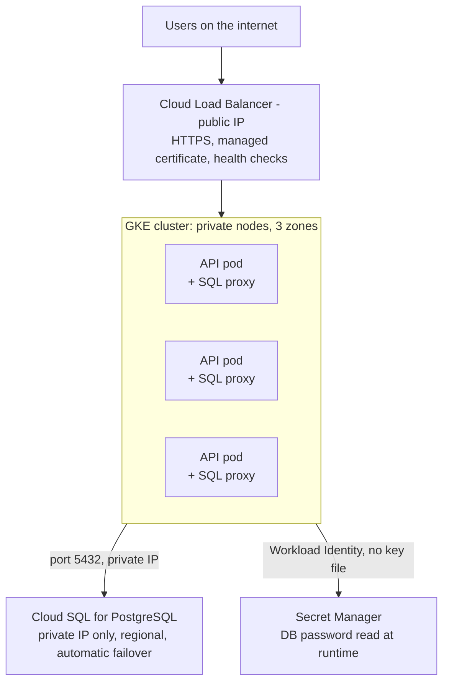

# Module 1: Cloud foundations and the two-tier application

A two-tier application is a presentation/application tier that talks directly to a data tier, with no separate middleware layer between them. In the cloud the question is never "can it run" but "what owns each failure mode": who scales the app, who backs up the database, who rotates the credentials, who holds the public IP.

**Reference architecture for the labs**

| Component | Choice | Why |
| --- | --- | --- |
| Tier 1: API | Python Flask container under gunicorn, stateless, 2+ replicas | Horizontal scaling and rolling updates only work if no request depends on a specific replica |
| Tier 2: Database | Cloud SQL for PostgreSQL (managed) | Backups, failover, patching, and encryption are the provider's job; running Postgres in a pod is a lab exercise, not a production default |
| Network | Custom VPC, private subnet for DB, no public IP on the DB | Only the API's service account can reach the DB, over private IP |
| Ingress | Cloud Load Balancer (HTTPS) in front of the API | TLS terminates at the edge; managed certificate |
| Identity | One service account per tier, least privilege | The API gets `cloudsql.client`; nothing gets `Owner` |

Traffic enters only through the load balancer; the API pods reach the database and the secret store over private paths using an identity scoped to their service account.

**Lab 1.1 (45 min): deploy the two tiers without Kubernetes first.** Interviewers like candidates who know what Kubernetes is replacing.

1. Create the VPC and a private subnet: `gcloud compute networks create two-tier-vpc --subnet-mode=custom` then `gcloud compute networks subnets create app-subnet --network=two-tier-vpc --range=10.10.0.0/24 --region=us-central1`.
2. Create the database with private IP only: `gcloud sql instances create two-tier-db --database-version=POSTGRES_16 --tier=db-f1-micro --region=us-central1 --network=two-tier-vpc --no-assign-ip` (enable Private Services Access when prompted). Create a database and a user.
3. Store the DB password in Secret Manager: `echo -n 'PASSWORD' | gcloud secrets create db-password --data-file=-`.
4. Deploy the API to Cloud Run with the Cloud SQL connector and the secret mounted as an env var: `gcloud run deploy api --source . --add-cloudsql-instances PROJECT:us-central1:two-tier-db --set-secrets DB_PASSWORD=db-password:latest --vpc-connector ...`.
5. Hit the public URL, confirm the API reads and writes rows, then note what you did NOT have to configure: TLS, autoscaling, health checks, log shipping. Those are the things you will configure by hand in Module 4.

**Concepts to be able to explain in two sentences each**

- Shared responsibility model: the provider secures the infrastructure; you secure what you put on it (IAM, data, network rules, app code).
- Regions vs zones: a zone is one failure domain; a region is several. A regional database with a standby in another zone survives a zone outage; a zonal one does not.
- Stateless vs stateful: stateless tiers scale out and roll freely; stateful tiers need storage, ordering, and a backup story. Push state down to managed services whenever you can.
- Private IP and Private Service Connect / VPC peering: how a managed DB is reachable from your VPC without a public address.
- Infrastructure as code: Terraform (multi-cloud) or Config Connector / CloudFormation / Bicep (native). The interview answer is "everything above is in Terraform; the console is for reading, not writing."

**Interview questions this module answers**

- Walk me through deploying a two-tier app to the cloud. (Use the table above as your outline: compute, data, network, ingress, identity.)
- Would you run the database in Kubernetes? (Default no for production; yes for dev/test or when a managed option does not exist. Name the trade-off: operational burden vs cost and control.)
- How does the app tier authenticate to the database without a password in the image? (Secret Manager at runtime, or IAM database authentication; never bake credentials into images.)
- What happens when a zone goes down? (Multi-zone node pool plus a regional DB with automatic failover; the load balancer stops routing to unhealthy backends.)
