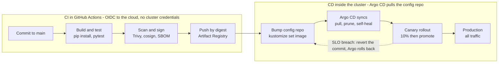

# Module 5: CI/CD pipelines

CI proves a commit is safe to ship; CD ships it. The modern answer separates them: CI builds, tests, scans, and signs an image, then writes the new digest to a Git repo; a GitOps controller inside the cluster notices the change and applies it. The pipeline never holds cluster credentials.



The top row runs in CI and ends by writing a new image digest to the config repo; the bottom row runs inside the cluster, where Argo CD applies it and a failed canary is undone by reverting that commit.

**Lab 5.1 (60 min): CI with GitHub Actions, keyless auth to Google Cloud**

First, one-time setup of Workload Identity Federation so the pipeline needs no long-lived key: create a workload identity pool and an OIDC provider for `https://token.actions.githubusercontent.com`, then bind a `ci-sa` service account (roles: `artifactregistry.writer`, `binaryauthorization.attestorsEditor`) to repository `YOUR_ORG/two-tier-app`.

```yaml
name: ci
on:
  push: { branches: [main] }
  pull_request:
permissions:
  contents: read
  id-token: write          # needed for OIDC
env:
  IMAGE: us-central1-docker.pkg.dev/PROJECT/apps/api
jobs:
  build:
    runs-on: ubuntu-latest
    outputs: { digest: ${{ steps.push.outputs.digest }} }
    steps:
      - uses: actions/checkout@v4
      - uses: actions/setup-python@v5
        with: { python-version: '3.12', cache: pip }
      - run: pip install -r requirements-dev.txt && python -m pytest
      - uses: google-github-actions/auth@v2
        with:
          workload_identity_provider: projects/NUM/locations/global/workloadIdentityPools/github/providers/github
          service_account: ci-sa@PROJECT.iam.gserviceaccount.com
      - run: gcloud auth configure-docker us-central1-docker.pkg.dev --quiet
      - uses: docker/build-push-action@v6
        id: push
        with:
          push: ${{ github.event_name == 'push' }}
          tags: ${{ env.IMAGE }}:${{ github.sha }}
          cache-from: type=gha
          cache-to: type=gha,mode=max
      - name: Scan image, fail on HIGH/CRITICAL
        uses: aquasecurity/trivy-action@0.28.0
        with:
          image-ref: ${{ env.IMAGE }}@${{ steps.push.outputs.digest }}
          severity: HIGH,CRITICAL
          exit-code: '1'
      - name: Sign image and attach SBOM
        if: github.event_name == 'push'
        run: |
          cosign sign --yes ${{ env.IMAGE }}@${{ steps.push.outputs.digest }}
          syft ${{ env.IMAGE }}@${{ steps.push.outputs.digest }} -o spdx-json > sbom.json
          cosign attest --yes --predicate sbom.json --type spdxjson ${{ env.IMAGE }}@${{ steps.push.outputs.digest }}

  promote:
    needs: build
    if: github.event_name == 'push'
    runs-on: ubuntu-latest
    steps:
      - uses: actions/checkout@v4
        with: { repository: YOUR_ORG/two-tier-config, token: "${{ secrets.CONFIG_REPO_PAT }}" }
      - run: |
          cd envs/staging
          kustomize edit set image api=${{ env.IMAGE }}@${{ needs.build.outputs.digest }}
          git config user.name ci && git config user.email ci@example.com
          git commit -am "api: ${{ github.sha }}" && git push
```

The pipeline's last act is a Git commit, not a `kubectl apply`. That is the GitOps boundary.

**Lab 5.2 (40 min): CD with Argo CD**

1. Install: `kubectl create ns argocd && kubectl apply -n argocd -f https://raw.githubusercontent.com/argoproj/argo-cd/stable/manifests/install.yaml`
2. Create a config repo `two-tier-config` with `base/` (your Module 4 manifests) and `envs/staging/`, `envs/prod/` Kustomize overlays.
3. Register an Application:

```yaml
apiVersion: argoproj.io/v1alpha1
kind: Application
metadata: { name: api-staging, namespace: argocd }
spec:
  project: default
  source:
    repoURL: https://github.com/YOUR_ORG/two-tier-config
    targetRevision: main
    path: envs/staging
  destination: { server: https://kubernetes.default.svc, namespace: two-tier }
  syncPolicy:
    automated: { prune: true, selfHeal: true }
    syncOptions: [CreateNamespace=true]
```

4. Push a change to the config repo and watch Argo sync it. Then `kubectl scale deployment api --replicas=1` by hand and watch `selfHeal` put it back to 3. That demonstration is the whole GitOps argument: Git is the source of truth and drift is corrected automatically.
5. Production promotion: a pull request from `envs/staging` to `envs/prod` with a required reviewer. The approval lives in Git history.

**Native alternative: Cloud Build + Cloud Deploy.** A `cloudbuild.yaml` with the same build, test, scan, sign steps, then `gcloud deploy releases create` into a delivery pipeline with staging and prod targets and a manual approval gate. On AWS: CodePipeline with CodeBuild and a manual approval action; on Azure: Azure Pipelines with environments and approvals. Name these, then say you would still prefer a GitOps controller for the cluster-side apply.

**Pipeline stages and what each one proves**

| Stage | Tool in the lab | Proves | Typical gate |
| --- | --- | --- | --- |
| Lint and unit test | pytest, ruff | Code works in isolation | Must pass on every PR |
| Build | Docker BuildKit | Reproducible image, cached layers | Image digest recorded |
| Scan | Trivy (image), tfsec/Checkov (IaC) | No known HIGH/CRITICAL CVEs or misconfigs | Fail the build |
| Sign and attest | cosign, syft (SBOM) | This exact image came from this pipeline | Admission policy verifies it |
| Deploy to staging | Argo CD automated sync | Runs in a real cluster | Smoke test / integration test |
| Promote to prod | PR to prod overlay, reviewer | Human accountability | Required approval |
| Progressive rollout | Argo Rollouts or GKE Gateway traffic split | Safe under real traffic | Error rate / latency SLO, auto-rollback |

**Interview questions this module answers**

- Describe a CI/CD pipeline you would build for a Kubernetes app. (Walk the table top to bottom; end with GitOps and progressive delivery.)
- Push-based vs pull-based deployment? (Push: pipeline has cluster credentials, simpler, bigger blast radius if the CI system is compromised. Pull/GitOps: controller in the cluster pulls from Git, no inbound credentials, drift detection, audit trail is Git.)
- How do you secure the pipeline itself? (OIDC/Workload Identity Federation instead of stored keys, least-privilege CI service account, pinned action versions, branch protection, signed commits, secrets in a vault not in CI variables, ephemeral runners.)
- How do you roll back? (GitOps: revert the commit; Argo syncs the old digest. Kubernetes-native: `kubectl rollout undo`. Database migrations: expand/contract pattern so the previous version still runs against the new schema.)
- How do you handle database migrations in the pipeline? (Run as a Kubernetes Job or Argo pre-sync hook, backward-compatible migrations only, never in the app container's startup path.)
